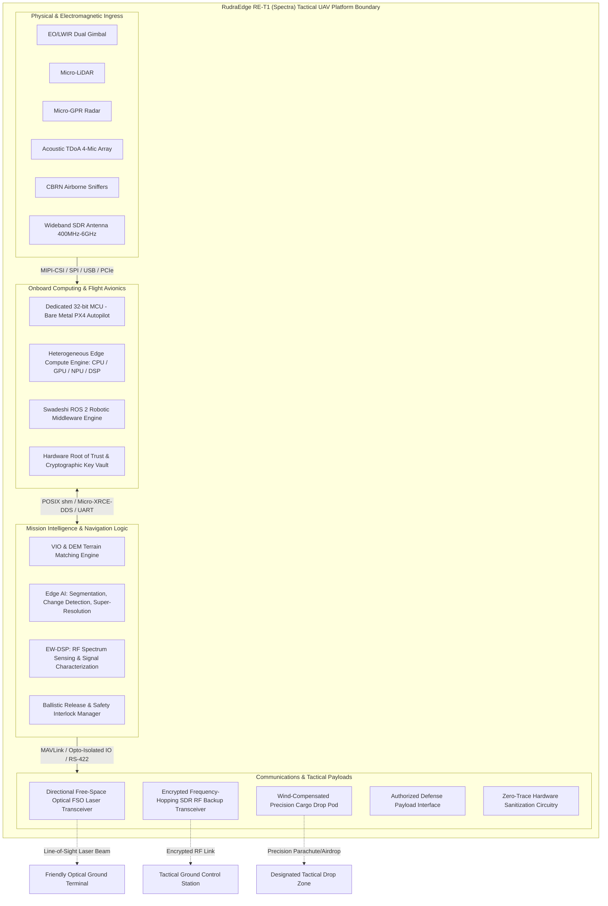

# Project Scope Baseline: RudraEdge RE-T1 (Spectra)
**Document Identifier:** `P01_Project_Scope_Baseline.md`  
**Internal Reference:** RE-iDEX-PROPOSAL-2026-R1 / TRAIN-002  
**Security Classification:** Commercial-in-Confidence / Internal Engineering Review  

---

## 1. Document Control

### 1.1 Document Metadata
| Metadata Field | Value |
|---|---|
| **Document Title** | Project Scope Baseline — RudraEdge RE-T1 (Spectra) Tactical UAS |
| **Document ID / Filename** | `P01_Project_Scope_Baseline.md` |
| **Project Name** | Project Rudra-Tactical \| Platform: RudraEdge RE-T1 (Spectra) |
| **Project Reference** | RE-iDEX-PROPOSAL-2026-R1 |
| **Target Evaluation Framework** | iDEX / DIO / MoD Evaluation Standard |
| **Prepared By** | Priyanka Sharma |
| **Assigned Engineering Role** | Systems Requirements & Configuration Engineer |
| **Authorizing Task Order** | TRAIN-002 (Requirements Baseline) |
| **Issue Date** | 22 October 2026 |
| **Document Version** | Version 0.1 — Initial Draft |
| **Document Status** | Draft — For Internal Engineering Review |
| **Primary Source Document** | `REA-T1-OVERVIEW-2026-V1.0` (*RudraEdge RE-T1 (Spectra) Project Introduction & Technical Overview*, authored by Sarvesh Sharma, Founder & Project Lead, RudraEdge Aerospace) |

### 1.2 Revision History
| Revision | Release Date | Author / Role | Description of Changes / Release Notes | Status |
|---|---|---|---|---|
| **v0.1** | 22 October 2026 | Priyanka Sharma<br>*Systems Requirements & Configuration Engineer* | Initial project scope baseline drafted under Task TRAIN-002. Formally establishes system boundaries, PECLF architectural mapping, functional allocations, constraint registers, assumptions register, interface dependencies, and open scope questions based on `REA-T1-OVERVIEW-2026-V1.0`. Prepared for internal engineering peer review. | Draft — For Internal Review |

---

## 2. Purpose

The purpose of this Project Scope Baseline document is to establish a rigorous, traceable, and unambiguous systems-engineering foundation for the RudraEdge RE-T1 (Spectra) autonomous tactical Unmanned Aerial Vehicle (UAV) platform. 

Specifically, this document:
1. **Defines System Scope and Physical/Logical Boundaries:** Delineates what constitutes the RE-T1 platform, including onboard sub-elements, ground integration points, sensory ingress paths, and computational substrates, preventing scope creep across multidisciplinary engineering teams.
2. **Decomposes Major System Functions:** Identifies and documents primary system-level functional capabilities derived from project commitments to support downstream functional requirements allocation.
3. **Establishes the Baseline for Requirements Engineering:** Acts as the authoritative source of truth for subsequent development of the System Requirements Specification (SRS), Subsystem Requirements Documents (SSRDs), Interface Control Documents (ICDs), and Verification Cross-Reference Matrices (VCRM).
4. **Governs Constraints and Assumptions:** Explicitly catalogs project, architectural, developmental, operational, and regulatory constraints, alongside an auditable register of engineering assumptions requiring multi-stakeholder validation.
5. **Differentiates Training Scope from Full Lifecycle Authorization:** Clearly segregates the activities authorized under training task `TRAIN-002` (local software/systems engineering, requirements modeling, and digital twin simulation analysis) from the broader 18-month capital-intensive physical fabrication, integration, and flight-testing roadmap.
6. **Catalogs Unresolved Decisions and Boundary Ambiguities:** Flags open technical questions, unconfirmed numeric thresholds, and interface ambiguities early in Milestone 1 (M1–4) before architecture freeze.

---

## 3. Project Overview

### 3.1 Platform Identity and Stated Purpose
The **RudraEdge RE-T1 (Spectra)**—designated under **Project Rudra-Tactical** (Reference: `RE-iDEX-PROPOSAL-2026-R1`)—is an advanced, sovereign, autonomous tactical Unmanned Aerial Vehicle (UAV) platform. It is engineered specifically for organic reconnaissance, surveillance, target acquisition (RSTA), and tactical logistics across contested, high-altitude, and electronically jammed frontier theaters, notably the Ladakh mountain corridor and Siachen Glacier.

### 3.2 Operational Challenges Addressed
The operational doctrine and technical architecture of the RE-T1 platform are synthesized to overcome six critical operational bottlenecks documented in legacy military and Commercial Off-The-Shelf (COTS) UAV systems:
*   **GNSS Denial & Electronic Jamming (Navigation Domain):** Conventional tactical drones experience severe drift, loss of attitude, or uncommanded fly-aways when satellite GPS/GNSS links and unhardened RF control vectors are subjected to adversary Electronic Warfare (EW). RE-T1 addresses this through drift-bounded, satellite-independent positioning.
*   **Extreme Environmental Stress (Aerospace Domain):** High-altitude Himalayan sectors feature reduced atmospheric air density ($\approx 0.5\text{ to }0.7\text{ kg/m}^3$), extreme sub-zero cold ($<-20^\circ\text{C}$), and sudden localized wind shear, drastically degrading aerodynamic lift, propeller thrust, motor thermal balance, and electrochemical battery discharge capacity.
*   **Information Overload & Link Latency (Data Link Domain):** Streaming uncompressed raw High-Definition (HD) or infrared video to Ground Control Stations (GCS) across contested electromagnetic environments incurs severe latency, saturates scarce tactical bandwidth, and invites electronic intercept/emitter triangulation by adversary SIGINT units.
*   **Visual & Radar Detectability (Signature Domain):** Legacy airframe profiles possess large Radar Cross-Sections (RCS) and unshielded acoustic and radio-frequency emissions, facilitating detection by hostile counter-UAS (C-UAS) radar networks and acoustic direction-finding grids.
*   **Supply Chain & Backdoor Vulnerabilities (Sovereignty Domain):** Heavy dependency on foreign-sourced flight controllers, proprietary closed-source firmware, and unverified foreign silicon exposes defense forces to hardware-level kill switches, malicious firmware backdoors, and sudden supply-chain sanctions.
*   **Hardware-Software Decoupling (Compute Domain):** Fragmented payload architectures prevent real-time sensor-level data from dynamically influencing onboard flight dynamics, terrain following, or collaborative situational awareness without manual intervention or ground-station compute dependency.

### 3.3 Core Engineering Innovations and Concepts
*   **Physical-Electromagnetic-Cyber Layer Fusion (PECLF):** An 8-layer unified system framework combining aerospace mechanics, cold-weather electric propulsion, multi-spectral optoelectronics, wideband RF spectrum sensing, hardware-level cryptographic trust, and real-time neural edge inference engines into a single synchronized tactical asset.
*   **Multi-Sensor Perception Suite:** Simultaneous airborne integration of stabilized dual-band daylight Electro-Optical / Long-Wave Infrared (EO/LWIR) imaging, lightweight micro-LiDAR, a 4-channel acoustic Time-Difference-of-Arrival (TDoA) microphone array, micro-Ground Penetrating Radar (micro-GPR) for subsurface anomaly detection, wideband Software-Defined Radio (SDR) spectrum sensing, and Chemical, Biological, Radiological, and Nuclear (CBRN) airborne hazard sniffers.
*   **Zero-Cloud Heterogeneous Edge AI:** Onboard deterministic execution of deep neural networks (CNNs, Vision Transformers, Siamese networks) utilizing a multi-core CPU, high-throughput GPU, specialized NPU blocks, and DSP kernels for INT8-quantized semantic segmentation, temporal change detection, and super-resolution without cloud or ground compute reachback.
*   **Resilient GNSS-Denied Navigation:** Continuous, drift-bounded 6-DOF navigation achieved via tight coupling of high-rate Visual-Inertial Odometry (VIO), high-grade IMU angular rate/acceleration fusion, and onboard Digital Elevation Model (DEM) terrain matching.
*   **Jam-Resistant Directional Communications:** Narrow-beam Free-Space Optical (FSO) directional laser communication transceivers utilizing Coarse-Fine Pointing, Acquisition, and Tracking (PAT) algorithms to establish line-of-sight data links immune to RF jamming, backed by frequency-hopping encrypted SDR channels.
*   **Sovereign Data Sovereignty and IP Integrity:** 100% Indian IP ownership across the flight control stack via a customized Swadeshi ROS 2 middleware and PX4 autopilot integration, hardware-enforced Secure Boot, cryptographic key vaults, zero-trace memory wiping upon physical tamper/capture, and an architectural roadmap targeting domestic C-DAC VEGA and IIT Madras SHAKTI processors.

### 3.4 Stated Development Lifecycle
Project Rudra-Tactical executes across an 18-month phased engineering lifecycle governed by a 5-Tier Make-in-India Indigenisation Framework and a strict 10-Tier Validation Ladder, transitioning from digital simulation to an investor-ready, field-evaluable tactical demonstrator:
*   **Milestone 1 (Months 1–4):** Simulation Digital Twin & System Requirements Specification (SRS) Freeze.
*   **Milestone 2 (Months 5–8):** Bench-Level Hardware-in-the-Loop (HIL) Integration & Thermal/Power Profiling down to $-20^\circ\text{C}$.
*   **Milestone 3 (Months 9–12):** Low-RCS Carbon-Composite Alpha Airframe Fabrication & Controlled Tethered/Free Flight Trials.
*   **Milestone 4 (Months 13–16):** Beta Integrated Multi-Modal Payload Prototype & Contested GNSS-Denied Corridor Trials.
*   **Milestone 5 (Months 17–18):** High-Altitude Pre-Induction Field Demonstrator & iDEX Defense Evaluation Dossier Generation.

### 3.5 Distinguishing Intended vs. Demonstrated Capabilities
> [!IMPORTANT]
> **Engineering Rigor Notice:** In accordance with systems-engineering governance, all capabilities described in `REA-T1-OVERVIEW-2026-V1.0` represent **intended design objectives and frozen proposal commitments** approved for the 18-month iDEX evaluation lifecycle. At the current project timeline (Milestone 1, Month 1, Task TRAIN-002), the system exists in its conceptual and digital simulation formulation phase. No capability documented herein may be classified as physically verified, flight-proven, certified, or field-qualified until it successfully ascends through its corresponding validation tier on the 10-Tier Validation Ladder.

---

## 4. System Scope

The system scope of the RudraEdge RE-T1 (Spectra) encompasses the complete multi-domain tactical unmanned aerial system, bounded by physical airframe enclosures, sensor transducers, computational buses, and secure communication apertures. The major functional scope areas are organized across the PECLF framework:



### 4.1 Scope Elements Overview
1. **Physical Perception and Sensor Ingress (Layer A):**
   * Multi-spectral day/night imaging via gyro-stabilized dual-sensor EO/LWIR gimbals over MIPI-CSI Gen3 buses.
   * Micro-LiDAR optical distance measurement and obstacle profiling.
   * Subsurface anomaly detection via high-frequency micro-Ground Penetrating Radar (GPR) over high-speed SPI/USB 3.0.
   * Acoustic impulse source localization using a 4-channel microphone array processed via Time-Difference-of-Arrival (TDoA) algorithms.
   * Chemical, Biological, Radiological, and Nuclear (CBRN) environmental hazard sniffing.
2. **Resilient Navigation and Autonomy (Layer B):**
   * High-rate 6-DOF kinematic state estimation fusing visual feature tracking (VIO), high-rate 3-axis IMU angular velocities/accelerations, and onboard high-resolution Digital Elevation Models (DEM).
   * Fully autonomous tactical flight management, waypoint following, search-and-rescue (SAR) path planning, and emergency Return-to-Home (RTH) procedures in GPS-denied and spoofed conditions.
   * Custom Swadeshi ROS 2 middleware orchestrating high-level mission nodes coupled with bare-metal PX4 autopilot flight controllers.
3. **Heterogeneous Edge Computing Fabric (Layer C):**
   * High-throughput heterogeneous computing matrix combining multi-core ARM/RISC-V CPUs, CUDA/TensorRT-compatible GPUs, specialized Neural Processing Units (NPUs), and Digital Signal Processors (DSPs).
   * High-speed, zero-copy inter-process communication utilizing POSIX shared memory (`shm`) and Linux loopback mechanisms under an air-gapped, real-time patched Linux operating system.
   * Strategic migration planning for architectural integration with indigenous Indian microprocessors (C-DAC VEGA and IIT Madras SHAKTI).
4. **Electromagnetic Awareness & EW-DSP (Layer D):**
   * Wideband Software-Defined Radio (SDR) ingress covering 400 MHz to 6 GHz over Gigabit Ethernet / PCIe (VITA 49 protocol).
   * Real-time RF spectrum monitoring, dynamic occupancy grid mapping, hostile radar/radio emitter characterization, and passive electronic surveillance.
5. **Secure Tactical Communications (Layer E):**
   * Primary Free-Space Optical (FSO) directional laser link featuring high-bandwidth, intercept-free data transit governed by Coarse-Fine Pointing, Acquisition, and Tracking (PAT) gimbal stabilization over RS-422.
   * Secondary fail-safe tactical Software-Defined Radio (SDR) link operating encrypted, frequency-hopping RF channels.
6. **Mission Intelligence and Edge AI (Layer F):**
   * Real-time INT8-quantized semantic segmentation for tactical terrain classification and obstacle masking.
   * Multi-temporal convolutional neural networks (CNNs) and Siamese architectures for automated visual change detection (identifying new vehicle tracks, fortifications, or surface disturbances).
   * Neural super-resolution algorithms enhancing optical and thermal reconnaissance frames under atmospheric haze, dust, and smoke.
7. **Authorized Effectors and Payloads (Layer G):**
   * Aerodynamically enclosed, wind-compensated precision cargo drop pod for emergency logistical supply delivery (medical, ammunition, power packs) with ballistic trajectory calculation.
   * Hardware/software interlocked electrical interfaces for authorized defense payload actuation, controlled via opto-isolated solid-state I/O and dual-redundant discrete logic.
8. **Cybersecurity and Data Sovereignty (Layer H):**
   * Hardware Root of Trust (RoT) integrated into the silicon substrate to cryptographically enforce Secure Boot.
   * Fully encrypted onboard non-volatile storage partitions housing operating system images, proprietary AI weights, DEM terrain maps, and tactical logs.
   * Automated, hardware-triggered zero-trace sanitization (flash and register memory wipe) executed upon tamper sensor trigger or anti-capture flag activation.
9. **Simulation, Digital Twin, and Verification Ladder:**
   * High-fidelity physics-based Gazebo simulation models incorporating Himalayan elevation profiles, severe thermal variations, low-density aerodynamic drag, sensor noise models, and synthetic EW interference.
   * Complete 10-Tier Validation Ladder protocol governing progressive verification from pure algorithm simulation through SIL, HIL, benchtop integration, environmental testing, and flight regimes.

---

## 5. In-Scope Activities

To maintain disciplined project execution, in-scope engineering activities are categorized into two distinct operational scopes:
1. **Overall 18-Month Project Scope (Approved Master Proposal Framework)**
2. **Current Training Authorization Scope (`TRAIN-002`, 22 October 2026)**

### 5.1 Overall 18-Month Project In-Scope Activities (RE-iDEX-PROPOSAL-2026-R1)
The broader project authorization encompasses the entire development lifecycle across Milestones M1 through M5:
*   Engineering specification, architectural definition, and formal freeze of the System Requirements Specification (SRS) for all 20 frozen capabilities.
*   Development and verification of a high-fidelity Gazebo Digital Twin platform integrated with PX4 Software-in-the-Loop (SIL) flight dynamics.
*   Training, optimization, ONNX export, and TensorRT INT8 quantization of edge deep learning models (semantic segmentation, change detection, super-resolution).
*   Design, assembly, wiring, and thermal/power profiling of benchtop Hardware-in-the-Loop (HIL) testbenches across $-20^\circ\text{C}$ to $+50^\circ\text{C}$.
*   Fabrication of low-RCS carbon-composite Alpha airframe prototypes incorporating radar-absorbing materials (RAM) and self-healing polymer matrices.
*   Integration of high-thrust electric propulsion, electronic speed controllers (ESCs), and thermally insulated cold-weather battery management systems.
*   Controlled tethered flight trials, open-air baseline flight trials, and deliberate GNSS-jammed flight corridor evaluations.
*   Physical installation and flight testing of the multi-modal sensor suite (EO/IR gimbal, micro-LiDAR, micro-GPR, acoustic array, CBRN sensor, FSO transceiver, cargo pod).
*   High-altitude field validation trials in Himalayan frontier sectors (Ladakh/Siachen regimes) and preparation of final iDEX defense evaluation dossiers.

### 5.2 Current Training Authorization In-Scope Activities (Task TRAIN-002)
The activities authorized under Task Order `TRAIN-002` are strictly bounded to desk-based systems engineering, requirements modeling, and digital artifacts:
*   Comprehensive technical review and decomposition of `REA-T1-OVERVIEW-2026-V1.0` and proposal documentation.
*   Drafting, formalization, and configuration control of the official Project Scope Baseline document (`P01_Project_Scope_Baseline.md`).
*   Identification, formalization, and maintenance of the project Constraints Register, Assumptions Register, and Open Scope Questions Register.
*   Mapping system-level functional capabilities to the 8-layer PECLF framework and defining inter-module interface boundaries.
*   Preparation of downstream requirements engineering structures (e.g., initial requirements decomposition templates, verification matrices, and traceability schemas).
*   Execution of local, free/open-source software analysis, structural text verification, and digital documentation workflows within the assigned workspace.

---

## 6. Out-of-Scope Activities and Boundaries

### 6.1 Explicitly Out-of-Scope Under Task Order TRAIN-002
The following activities are strictly prohibited and outside the scope of authorization for Task `TRAIN-002`:
*   **Live Flight Testing:** No operation of unmanned aerial vehicles, indoor tethered rigs, or open-air flight trials.
*   **Outdoor Deployment:** No field trials, high-altitude range testing, environmental chamber access, or outdoor sensor characterization.
*   **Physical Hardware Integration:** No physical handling, wiring, breadboarding, soldering, benchtop HIL assembly, or mechanical fabrication.
*   **Hardware and Prototype Procurement:** No procurement of sensors, compute modules, airframe composite tooling, batteries, or flight controllers.
*   **Paid Commercial Services:** No utilization of paid cloud platforms (AWS, Azure, GCP), paid commercial APIs, proprietary software licenses, or external consulting services.
*   **Personal Financial Expenditure:** No commitment of company capital or personal financial outlay.

### 6.2 Delineation: Training Boundaries vs. Wider Project Roadmap
> [!NOTE]
> It is vital to note that the exclusions listed in Section 6.1 apply strictly to the **current training authorization (`TRAIN-002`)**. These exclusions do **not** imply that physical prototyping, flight testing, or hardware procurement are excluded from Project Rudra-Tactical as a whole. On the contrary, physical HIL benches (Milestone 2), Alpha airframe flights (Milestone 3), Beta multi-sensor trials (Milestone 4), and high-altitude field demonstrations (Milestone 5) represent mandatory, contractually committed milestones of the 18-month master iDEX roadmap.

---

## 7. Major System Functions

The following table formally captures the major system-level functions derived from `REA-T1-OVERVIEW-2026-V1.0`. In accordance with systems engineering governance, draft identifiers (`FUNC-DFT-xxx`) are assigned for baseline tracking pending formal SRS requirements numbering.

| Function ID | System Function | Description | Relevant Subsystem / Layer | Source Reference |
|---|---|---|---|---|
| **FUNC-DFT-001** | Multi-Spectral Ingress & Synchronization | Capture, hardware-synchronize, and ingest daylight optical CMOS, uncooled Long-Wave Infrared (LWIR) bolometer, and micro-LiDAR datastreams over dedicated high-speed digital camera interfaces. | Module 02 / Layer A (Perception & Ingress) | Section 3.1, Section 7 (Module 02), Section 8.2 |
| **FUNC-DFT-002** | Acoustic Impulse Localization | Ingest 4-channel microphone acoustic pressure signals and execute Time-Difference-of-Arrival (TDoA) algorithms to compute hostile acoustic emission bearing vectors. | Module 04 / Layer A (Perception) & Layer D (EW-DSP) | Section 4 (Domain 5), Section 7 (Module 04), Section 8.2 |
| **FUNC-DFT-003** | Subsurface Radar Ingress | Capture and process micro-Ground Penetrating Radar (GPR) backscatter signals over high-speed SPI/USB to detect buried metallic/non-metallic tactical anomalies. | Module 04 / Layer A (Perception) & Layer C (Compute) | Section 4 (Domain 8), Section 7 (Module 04), Section 8.2 |
| **FUNC-DFT-004** | Airborne CBRN Hazard Monitoring | Ingest and condition transducer signals from onboard airborne sensors to detect and map localized chemical, biological, radiological, and nuclear hazard plumes. | Module 02 / Layer A (Perception) | Section 3.1, Section 4 (Domain 8), Section 7 (Module 02) |
| **FUNC-DFT-005** | GNSS-Denied 6-DOF State Estimation | Fuse high-rate 3-axis IMU angular velocities/accelerations with visual feature tracks (VIO) and onboard DEM terrain elevation data using Kalman filtering to maintain drift-bounded pose under GPS jamming. | Module 01 / Layer B (Navigation & Autonomy) | Section 2.2 (Obj 1), Section 7 (Module 01), Section 10.1 |
| **FUNC-DFT-006** | Real-Time Attitude & Trajectory Execution | Compute microsecond PWM motor commands and servo actuations via dedicated bare-metal flight controller running custom PX4 autopilot firmware to maintain aerodynamic stability. | Layer B (Navigation & Autonomy) / Flight Firmware | Section 5.2 (Stage 4), Section 6.1 (Layer 2), Section 8.3 |
| **FUNC-DFT-007** | Zero-Cloud Edge Semantic Segmentation | Execute real-time INT8-quantized deep convolutional neural networks directly on onboard GPU/NPU/DSP heterogeneous hardware to generate pixel-level tactical terrain and obstacle classification masks. | Module 03 / Layer C (Compute) & Layer F (AI Models) | Section 2.2 (Obj 2), Section 6.3, Section 7 (Module 03) |
| **FUNC-DFT-008** | Multi-Temporal Visual Change Detection | Perform real-time comparative inference using Siamese neural networks across aligned historical satellite/UAV terrain embeddings and live video to detect infrastructure changes or vehicle movements. | Module 03 / Layer F (Mission Intelligence & AI) | Section 4 (Domain 1), Section 6.1 (Layer 4), Section 7 (Module 03) |
| **FUNC-DFT-009** | Multi-Spectral Neural Super-Resolution | Process degraded optical and thermal video streams using edge neural super-resolution networks to synthesize high-clarity intelligence imagery in smoke, dust, and low-visibility weather. | Module 03 / Layer F (Mission Intelligence & AI) | Section 4 (Domain 1), Section 7 (Module 03) |
| **FUNC-DFT-010** | RF Spectrum Sensing & Characterization | Scan wideband RF spectrum (400 MHz to 6 GHz) via onboard Software-Defined Radio (SDR) and execute digital FIR/IIR filtering to construct RF occupancy grids and isolate hostile radar/radio signatures. | Module 04 / Layer D (Electromagnetic Awareness) | Section 4 (Domain 5), Section 7 (Module 04), Section 8.2 |
| **FUNC-DFT-011** | Jam-Resistant Directional Laser Communication | Point, acquire, and track (PAT) friendly optical ground terminals to modulate and transmit high-bandwidth intelligence and vehicle telemetry over narrow-beam Free-Space Optical (FSO) laser links. | Module 05 / Layer E (Secure Communications) | Section 2.2 (Obj 6), Section 7 (Module 05), Section 8.2 |
| **FUNC-DFT-012** | Encrypted Tactical SDR Fallback Transit | Establish and maintain secondary frequency-hopping, cryptographically encrypted RF communications for command, telemetry, and low-bandwidth mission reporting when FSO is obscured. | Module 05 / Layer E (Secure Communications) | Section 2.2 (Obj 6), Section 4 (Layer E), Section 8.2 |
| **FUNC-DFT-013** | Wind-Compensated Ballistic Release Management | Calculate instantaneous ballistic release trajectories based on real-time local wind vectors, ground speed, and radar altitude, triggering precision cargo pod unlatch mechanisms. | Module 06 / Layer G (Authorized Effectors & Payloads) | Section 4 (Layer G), Section 7 (Module 06), Section 8.2 |
| **FUNC-DFT-014** | Authorized Payload Safety Interlocking | Inforce dual-redundant opto-isolated solid-state hardware logic interlocks to prevent uncommanded actuation, inadvertent release, or unauthorized payload firing during boot or fault states. | Module 06 / Layer G (Authorized Effectors & Payloads) | Section 8.2, Section 8.3 |
| **FUNC-DFT-015** | Continuous Platform Health & Thermal Audit | Monitor core compute temperatures, battery voltage/discharge rates, vibration levels, and inter-bus collision metrics via automated hardware watchdog routines to guarantee fail-operational integrity. | Layer C (Compute) & Layer B (Autonomy) | Section 5.2 (Stage 6), Section 8.3, Section 10.1 (Tier 4) |
| **FUNC-DFT-016** | Hardware Root-of-Trust & Cryptographic Boot | Validate the cryptographic authenticity and integrity of all system firmware, kernel binaries, and ROS 2 middleware modules from silicon power-on before authorizing execution. | Layer H (Cybersecurity & Data Sovereignty) | Section 2.2 (Obj 7), Section 6.3, Section 8.3 |
| **FUNC-DFT-017** | Automated Zero-Trace Anti-Tamper Sanitization | Trigger irreversible hardware-level sanitization and cryptographic flash memory erasure upon detection of unauthorized physical enclosure breach, anti-tamper switch trip, or capture. | Layer H (Cybersecurity & Data Sovereignty) | Section 2.2 (Obj 7), Section 4 (Layer H), Section 5.2 (Stage 6) |

---

## 8. System Architecture and Boundaries

### 8.1 The 8-Layer PECLF Framework
The foundational architecture of the RudraEdge RE-T1 platform is the **Physical-Electromagnetic-Cyber Layer Fusion (PECLF)** framework. Unlike conventional unmanned systems that operate disparate sensors and compute modules as isolated silos, the PECLF framework establishes a synchronized, deterministic multi-domain pipeline.

| Layer Identifier | Layer Name | Principal Functional Responsibility | Documented Inter-Layer Relationships & Data Transfers |
|---|---|---|---|
| **Layer A** | Physical Perception | Captures multi-spectral visual, thermal, acoustic, electromagnetic, and subsurface physical phenomena across dedicated sensors without external network reliance. | Streams raw uncalibrated byte frames and analog signals via MIPI-CSI, high-speed SPI, USB, and PCIe into Layer C for conditioning; interfaces micro-switches to Layer H. |
| **Layer B** | Navigation & Autonomy | Solves high-frequency 6-DOF spatial kinematic state estimations and drives flight stabilization and mission path coordination. | Ingests pre-conditioned VIO feature points and DEM profiles from Layer C; passes high-rate kinematic pose to PX4 attitude loops; issues waypoint commands to Layer C/F. |
| **Layer C** | Heterogeneous Edge Compute Fabric | Acts as the central high-throughput processing substrate (CPU/GPU/NPU/DSP) executing zero-cloud algorithms, sensor conditioning, and middleware routing. | Ingests raw data from Layer A; exchanges low-latency telemetry with Layer B via micro-XRCE-DDS; hosts shared host memory (POSIX `shm`) for Layers D, E, and F. |
| **Layer D** | Electromagnetic Awareness | Monitors contested RF spectrum, performs signal intelligence (SIGINT), evaluates acoustic TDoA vectors, and characterizes hostile radar/radio emitters. | Feeds RF occupancy grids, emitter vectors, and hostile jamming telemetry into Layer B (for EW-evasive path routing) and Layer E (for RF link adaptation). |
| **Layer E** | Secure Communications | Manages narrow-beam directional optical laser transceivers (FSO) and secondary frequency-hopping encrypted SDR RF links for air-to-ground data transit. | Receives serialized tactical intelligence, high-priority imagery, and vehicle telemetry from Layer F/C; passes incoming ground command packets to Layer B. |
| **Layer F** | Mission Intelligence & AI | Executes deep neural inference for semantic segmentation, temporal visual change detection, object classification, and search coverage optimization. | Consumes synchronized image tensors and historical terrain maps from Layer C; generates detection bounding boxes and target coordinates passed to Layer B, E, and G. |
| **Layer G** | Authorized Effectors & Payloads | Controls precision wind-compensated logistical cargo drop pods and authorized tactical payload hardware under strict interlocked authority. | Receives release commands from Layer B/F; governed by dual-redundant hardware logic interlocks and cryptographic authorization boundaries enforced by Layer H. |
| **Layer H** | Cybersecurity & Data Sovereignty | Enforces hardware root of trust from cold boot, maintains encrypted local partitions, and manages automated zero-trace memory wiping upon tamper detection. | Cryptographically interlocks boot authorization for Layers B, C, and G; monitors physical tamper sensors from Layer A; triggers instantaneous emergency memory erase. |

### 8.2 Major Architectural Boundaries and Isolation Protocols
To achieve military-grade airworthiness and mission survivability, the RE-T1 architecture enforces five strict structural firewalls:

```
+-----------------------------------------------------------------------------------+
|               NON-FLIGHT-CRITICAL MISSION & INTELLIGENCE DOMAIN                   |
|  [Layer C, D, E, F: Linux OS w/ Real-Time Patches | Heterogeneous GPU/NPU/DSP]    |
|   - Deep Neural Inference (Semantic Segmentation, Change Detection, Super-Res)    |
|   - High-Bandwidth Free-Space Optical (FSO) PAT & SDR RF Ingress                  |
|   - Micro-GPR Subsurface Processing & Wideband RF Spectrum Mapping                |
+-----------------------------------------------------------------------------------+
                                         |
     ==================== ARCHITECTURAL FIREWALL 1 ====================
     * Micro-XRCE-DDS over High-Speed UART / Opto-Isolated Bus
     * Asynchronous Heartbeat Watchdog & Message Decoupling
     * Complete Memory & Operating System Physical Segregation
                                         |
+-----------------------------------------------------------------------------------+
|                 FLIGHT-CRITICAL AVIONICS & STABILIZATION DOMAIN                   |
|  [Layer B: Bare-Metal 32-Bit Microcontroller (STM32) | Custom PX4 Autopilot]       |
|   - 1000 Hz Inner Attitude Stabilization & Rate Gyro Closed Loops                 |
|   - Direct PWM Motor ESC Thrust Control & Aerodynamic Control Surface Actuation   |
|   - Independent Fail-Safe Return-to-Home (RTH) & Dead-Reckoning Navigation         |
+-----------------------------------------------------------------------------------+
```

1. **Flight-Critical Control vs. High-Level AI Processing:**
   * *Physical and OS Decoupling:* The flight stabilization stack executes on a dedicated bare-metal 32-bit microcontroller (STM32 series) running custom PX4 autopilot firmware. It is physically and electrically segregated from the multi-core Linux edge compute substrate hosting AI algorithms.
   * *Zero-Overhead Watchdog:* If an edge deep-learning model encounters an unhandled exception, segmentation fault, or kernel thrashing, the bare-metal flight controller autonomously isolates the link, maintains stable attitude hold, and executes deterministic waypoint navigation or RTH without performance degradation.
2. **Sensor Ingress vs. Downstream Processing:**
   * *Direct Memory Access (DMA):* High-bandwidth camera streams (EO/LWIR) bypass the host CPU entirely via multi-lane MIPI-CSI Gen3 direct DMA buffers into GPU/NPU memory spaces, eliminating CPU frame drops.
   * *Dedicated DSP Threads:* Micro-GPR and acoustic transducer arrays stream into high-speed SPI/USB ring buffers governed by dedicated DSP kernel threads to prevent memory buffer starvation.
3. **Internal Processing vs. External Communications:**
   * *Strict RF Shielding:* SDR radio frequency ingress lines are routed through dedicated electromagnetic interference (EMI) gaskets, isolating RF reception circuits from high-current motor ESC lines.
   * *Air-Gapped Local Networking:* Inter-process communication between software nodes is restricted to local POSIX shared memory (`shm`) or loopback Unix domain sockets. Physical and logical controls forbid unauthenticated external network bridging.
4. **Mission Functions vs. Cybersecurity Controls:**
   * *Cryptographic Key Vaults:* Mission AI models and telemetry streams operate in encrypted partitions unlocked only by hardware-validated keys managed by the silicon Root of Trust.
   * *Hardware-Enforced Sanitization:* Zero-trace memory erasure routines are hardwired to physical tamper switches, executing independent of operating system intervention upon airframe rupture or physical breach.
5. **Autopilot vs. Authorized Effectors:**
   * *Dual-Redundant Logic Interlocking:* Effector actuation lines (e.g., cargo drop release) utilize opto-isolated solid-state I/O requiring dual-redundant discrete confirmation signals, preventing uncommanded release during boot transients or subsystem fault conditions.

---

## 9. Constraints

The following register formally records all technical, operational, resource, developmental, and governance constraints applicable to Project Rudra-Tactical and Task `TRAIN-002`.

| Constraint ID | Constraint Description | Category | Source / Reason | Status / Clarification |
|---|---|---|---|---|
| **CST-TRN-001** | **Zero Physical Deployment:** No live flight testing, tethered outdoor flight, or field deployment is permitted under the current training task order. | Operational / Authorization | Task Order `TRAIN-002` Scope Restrictions | **Active & Mandatory:** Bounded strictly to desk-based systems engineering, modeling, and documentation. |
| **CST-TRN-002** | **Zero Physical Hardware Procurement / Integration:** Physical handling, wiring, prototype procurement, and bench assembly are prohibited under `TRAIN-002`. | Resource / Authorization | Task Order `TRAIN-002` Scope Restrictions | **Active & Mandatory:** Physical HIL and airframe assembly are scheduled for later project milestones (M2–M5). |
| **CST-TRN-003** | **Zero Paid External Services:** All engineering analysis and documentation must utilize local, free, open-source, or pre-authorized resources. No paid APIs, commercial cloud instances, or personal outlays. | Financial / Resource | Task Order `TRAIN-002` Financial Controls | **Active & Mandatory:** Strictly enforced. No commercial SaaS or external paid computation permitted. |
| **CST-ARC-001** | **Zero Public-Cloud Architecture:** The operational platform must execute all sensor conditioning, state estimation, AI inferencing, and mission logic entirely onboard. | Technical / Architectural | `REA-T1-OVERVIEW-2026-V1.0`, Sec 1.1, Sec 2.2 | **Confirmed Requirement:** No operational runtime dependency on external or cloud infrastructure is permitted. |
| **CST-ARC-002** | **Physical Isolation of Flight Control:** The PX4 flight stabilization stack must execute on a dedicated bare-metal microcontroller independent of the Linux edge compute operating system. | Safety / Architectural | `REA-T1-OVERVIEW-2026-V1.0`, Sec 8.3 | **Confirmed Requirement:** Ensures that AI exceptions or memory thrashing cannot corrupt core flight safety loops. |
| **CST-ARC-003** | **Air-Gapped Internal Communications:** All onboard inter-process communications must execute over local shared memory (POSIX `shm`) or local loopback sockets with no unvetted external connections. | Security / Architectural | `REA-T1-OVERVIEW-2026-V1.0`, Sec 8.3 | **Confirmed Requirement:** Protects platform against unauthorized remote network ingress and data exfiltration. |
| **CST-SOV-001** | **100% Sovereign Software IP:** Core flight control stacks, neural network architectures, and hardware root-of-trust protocols must maintain 100% sovereign ownership without foreign proprietary firmware dependencies. | Strategic / Sovereignty | `REA-T1-OVERVIEW-2026-V1.0`, Sec 1.1, Sec 2.2 | **Confirmed Requirement:** Mandates Swadeshi ROS 2 + custom PX4, with migration roadmap to VEGA/SHAKTI silicon. |
| **CST-ENV-001** | **Himalayan Environmental Envelope:** The physical system must ultimately operate across low air densities ($\approx 0.5\text{ to }0.7\text{ kg/m}^3$), low ambient pressures, and temperatures down to $-20^\circ\text{C}$. | Environmental | `REA-T1-OVERVIEW-2026-V1.0`, Sec 2.1, Sec 9.2, Sec 10.1 | **Confirmed Design Target:** Drives cold-weather propulsion, passive thermal enclosures, and Tier 5 chamber testing. |
| **CST-PRC-001** | **Sequential Validation Progression:** No subsystem or flight software build may enter physical flight trials without passing validated benchtop testbench logs and formal gate sign-offs. | Process / Governance | `REA-T1-OVERVIEW-2026-V1.0`, Sec 10.1, Sec 10.2 | **Confirmed Requirement:** Enforces strict compliance with the 10-Tier Validation Ladder prior to milestone transitions. |

---

## 10. Assumptions Register

The following register documents genuine engineering assumptions necessary to interpret, baseline, and plan the engineering work. In accordance with systems-engineering best practices, unverified assumptions are marked as "Pending Confirmation" and tracked for closure.

| Assumption ID | Assumption Statement | Rationale / Context | Impact if Incorrect | Validation / Confirmation Needed | Status |
|---|---|---|---|---|---|
| **ASM-ENG-001** | **Requirements Traceability Schema (D1–D20):** It is assumed that the "20 frozen iDEX deliverables (D1 through D20)" referenced in `REA-T1-OVERVIEW-2026-V1.0` (Sec 10.2) map directly to the "20 frozen advanced capabilities" mentioned in Sec 1.4 and Sec 11.1. | The technical overview text explicitly mentions both terms but does not provide the itemized 1-to-20 alphanumeric list. | Inability to establish a 1-to-1 traceability matrix between functional requirements and official iDEX contract deliverables. | Systems Engineering lead (Sarvesh Sharma) must provide the frozen iDEX proposal deliverable annex (D1 to D20). | **Pending Confirmation** |
| **ASM-ENG-002** | **Numerical Flight Performance Thresholds:** It is assumed that quantitative flight thresholds (maximum takeoff weight [MTOW], operational ceiling, endurance hours, max wind resistance, and payload capacity in kg) exist in a separate classified annex or proposal document. | `REA-T1-OVERVIEW-2026-V1.0` outlines operational regimes (Ladakh, Siachen, high-altitude low density) but omits specific numerical aerodynamic thresholds. | Downstream engineering teams may design sizing, propulsion, and structural enclosures to divergent performance goals. | Authoritative release of the frozen proposal technical specification sheet or Key Performance Parameters (KPP) table. | **Pending Confirmation** |
| **ASM-ENG-003** | **Baseline Compute Silicon Architecture:** It is assumed that Milestone 1 and Milestone 2 development utilizes commercial heterogeneous boards (e.g., NVIDIA Jetson Orin / standard STM32) prior to progressive migration to C-DAC VEGA or IIT Madras SHAKTI. | The source document specifies an evaluation roadmap toward VEGA/SHAKTI silicon while citing TensorRT (an NVIDIA-specific SDK) and STM32 MCUs in Sec 6.1 and Sec 7. | Incompatible toolchains, compiler differences, and delay in containerized microservice porting to domestic RISC-V architectures. | Project leadership confirmation of the exact compute development board hardware designated for Milestone 1 SIL and Milestone 2 HIL. | **Pending Confirmation** |
| **ASM-ENG-004** | **Sub-Meter VIO-NAV Drift Bound Definition:** It is assumed that the "sub-meter drift bounds sustained" success criterion for Tier 8 GNSS-denied testing (Sec 10.1) denotes either sub-meter drift per kilometer flown or a localized closed-loop drift radius. | Pure "sub-meter" without a distance or temporal qualifier is ambiguous in long-endurance autonomous navigation. | Flight navigation algorithms may pass nominal short-distance tests but fail tactical long-range mission endurance requirements. | Guidance from GNC (Guidance, Navigation & Control) lead on the precise mathematical metric for VIO/DEM drift bounds. | **Pending Confirmation** |
| **ASM-ENG-005** | **Swadeshi ROS 2 Architecture & Distribution:** It is assumed that "Swadeshi ROS 2" is an internally customized, hardened fork of standard open-source ROS 2 (e.g., Humble or Iron) patched with real-time DDS and secure air-gapped policies. | `REA-T1-OVERVIEW-2026-V1.0` references Swadeshi ROS 2 repeatedly but does not specify the base distribution or proprietary delta. | Inconsistencies in middleware node compilation, message serialization formats, and DDS QoS profiles across developer environments. | Software Architecture lead must provide the Swadeshi ROS 2 repository configuration and baseline release notes. | **Pending Confirmation** |

---

## 11. Dependencies and External Interfaces

### 11.1 Documented Inter-Module and Subsystem Dependencies
1. **Sensory Ingress to Central Compute:**
   * *EO/LWIR to Edge Compute:* High-speed multi-lane MIPI-CSI Gen3 delivering raw YUV, RGB, and 14-bit uncooled thermal tensors directly into host memory via DMA, bypassing host CPU to maintain zero frame drop.
   * *Micro-GPR & Acoustic Array to Compute:* High-speed SPI and USB 3.0 transferring 16-bit IQ radar backscatter samples and acoustic Pulse-Density Modulation (PDM) audio arrays into prioritized DSP ring buffers.
   * *SDR RF Ingress to Compute:* Gigabit Ethernet or PCIe interfaces streaming digitized RF frames using the VITA 49 (ANSI/VITA 49.0/.2 Radio Transport) standard with dedicated EMI shielding.
2. **Compute to Flight Control (Autopilot Integration):**
   * *Micro-XRCE-DDS & MAVLink 2.0:* Bidirectional serial/UART and Ethernet communication bridging Swadeshi ROS 2 mission coordination nodes to PX4 autopilot flight tasks.
   * *Hardware Watchdog Heartbeats:* Hardware-timed discrete pinging verifying that edge intelligence nodes remain operational; failure triggers immediate autopilot failsafe.
3. **Compute to Effector / Communication Peripherals:**
   * *FSO Gimbal Control:* High-speed RS-422 serial bus transmitting closed-loop coarse-fine gyro coordinate offsets to FSO gimbal tracking motors to sustain laser line-of-sight under wind shear.
   * *Payload Release Interlock:* Dual-redundant discrete opto-isolated solid-state I/O lines providing isolated physical release trigger signals.

### 11.2 External Physical and Operational Interfaces
*   **Tactical Ground Control Station (GCS):** Receives primary directional high-speed Free-Space Optical (FSO) laser beams at friendly optical ground terminals; secondary reception via encrypted frequency-hopping SDR RF channels.
*   **Tactical Drop Zone:** Physical ground interface receiving wind-compensated precision cargo delivery packages released via mechanical pod unlatch mechanisms.
*   **GNSS / Electromagnetic Spectrum:** Interacts passively with contested ambient RF environments (400 MHz to 6 GHz) for emission monitoring; designed specifically to operate without external RF satellite navigation dependencies.

---

## 12. Open Questions and Clarifications

The following table records material open technical and scope questions identified during the source review of `REA-T1-OVERVIEW-2026-V1.0`. These items require formal resolution to ensure requirements completeness.

| Question ID | Open Question / Scope Ambiguity | Operational & Engineering Impact | Relevant Source Section | Required Clarification / Action |
|---|---|---|---|---|
| **QUE-SCP-001** | What are the exact technical specifications and itemized definitions of the **"20 frozen advanced capabilities"** and **"D1 through D20 deliverables"**? | Prevents full decomposition of system-level functional requirements; risks omissions in downstream requirements baseline. | Section 1.4, Section 10.2, Section 11.1 | Systems Engineering Lead to release the frozen iDEX Proposal Capability Annex listing D1 through D20. |
| **QUE-SCP-002** | What are the quantitative **flight performance envelopes** (MTOW, empty weight, maximum payload mass, flight endurance, service ceiling, and maximum operational wind limits)? | Essential for mechanical sizing, aerodynamic modeling in Gazebo, motor/ESC selection, and propulsion thermal modeling. | Section 1.4, Section 2.1, Section 5.1 | Aerospace & Flight Dynamics lead to define nominal and threshold KPP values for the RE-T1 airframe. |
| **QUE-SCP-003** | What specific **FSO optical wavelength band** is utilized, and what are its operational atmospheric limitations in heavy Himalayan cloud/fog? | In extreme weather (dense fog/snow), optical laser scattering occurs. The switching threshold between primary FSO and fallback SDR RF must be deterministically defined. | Section 2.2, Section 7 (Module 05), Section 8.2 | Optical Communications team to provide FSO optical wavelength, divergence angle, link budget, and RF failover criteria. |
| **QUE-SCP-004** | What is the definitive hardware selection for the **Heterogeneous Edge Compute Engine** during Milestones M1 through M3? | The overview cites NVIDIA TensorRT (proprietary NVIDIA ecosystem) alongside STM32 MCUs, while mandating migration to C-DAC VEGA / IIT-M SHAKTI. Toolchain parity must be planned. | Section 2.2, Section 6.1, Section 7 (Module 03) | Chief Architect to confirm initial reference SBC (e.g., Jetson AGX Orin Industrial vs custom board) and target migration milestones. |
| **QUE-SCP-005** | How is **CBRN sensor data** processed and acted upon within the onboard autonomy stack? | Section 3.1 and Section 7 list CBRN sensors in Layer A, but Layer F and Section 6.1 omit specific CBRN neural models, plume dispersion mapping, or automated reporting protocols. | Section 4 (Layer A), Section 5.1, Section 7 (Module 02) | Mission Intelligence team to clarify whether CBRN processing involves simple threshold alerting via MAVLink or localized hazard plume modeling. |
| **QUE-SCP-006** | What specific **optical and RF ground terminal infrastructure** is required to support the FSO and SDR links during flight trials? | The external interface to friendly ground terminals is critical to complete the end-to-end communication link baseline. | Section 7 (Module 05), Section 8.2 | Communications team to define whether ground optical terminals are part of the RE-T1 project scope or external Government Furnished Equipment (GFE). |

---

## 13. Scope Risks and Boundary Issues

The following evidence-based scope risks have been identified based on the system definition, multidisciplinary dependencies, and operational objectives:

### 13.1 Technical and Boundary Risks
*   **RSK-SCP-001: High-Coupling Middleware Latency Between ROS 2 and PX4**
    *   *Description:* The architecture couples Swadeshi ROS 2 with PX4 Autopilot over Micro-XRCE-DDS via serial/UART buses. High-rate VIO kinematic pose injection into the PX4 state EKF requires sub-millisecond determinism.
    *   *Potential Impact:* Bus latency spikes or serial buffer overflow could introduce lag into the flight control loop, triggering attitude instability during GNSS-denied maneuvers.
    *   *Mitigation / Control:* Enforce strict Tier 3 HIL success criteria requiring inner-loop latency under 1 millisecond; benchmark Micro-XRCE-DDS transport over high-speed baud rates and SPI/Ethernet links.
*   **RSK-SCP-002: Toolchain Divergence in Silicon Sovereignty Roadmap**
    *   *Description:* Baseline deep-learning models are optimized using NVIDIA TensorRT for INT8 post-training quantization on CUDA-enabled GPUs, whereas the long-term project vision targets indigenous RISC-V silicon (C-DAC VEGA / IIT Madras SHAKTI).
    *   *Potential Impact:* Proprietary TensorRT-specific optimizations and layer fusions will not run directly on domestic RISC-V / NPU accelerators without extensive re-compilation or architectural redesign.
    *   *Mitigation / Control:* Mandate intermediate representation model exports in standard ONNX format; preserve framework-agnostic quantization pathways alongside TensorRT builds.
*   **RSK-SCP-003: Multi-Sensor Ingress Thermal Saturation at Low Temperatures**
    *   *Description:* Simultaneous execution of dual EO/IR gimbals, micro-LiDAR, micro-GPR, acoustic DSP, SDR RF ingress, and edge neural inference generates substantial thermal dissipation in confined composite airframes, contrasted against ambient temperatures down to $-20^\circ\text{C}$.
    *   *Potential Impact:* Uneven thermal gradients may cause localized condensation, sensor calibration drift, or battery efficiency collapse.
    *   *Mitigation / Control:* Execute comprehensive bench-level thermal profiling down to $-20^\circ\text{C}$ during Milestone 2 (M5–8); model passive and active thermal management in environmental chambers (Tier 5).
*   **RSK-SCP-004: Boundary Ambiguity Regarding Ground Segment Deliverables**
    *   *Description:* The technical overview heavily details the airborne platform but leaves Ground Control Station (GCS) hardware and optical ground receiver terminals undefined.
    *   *Potential Impact:* Risk of scope creep or unallocated interface responsibilities between airborne transceiver engineers and ground station operators.
    *   *Mitigation / Control:* Formally define the system boundary at the airborne optical/RF transmit apertures and document GCS interfaces as external dependencies in the upcoming Interface Control Document (ICD).

---

## 14. Scope Acceptance and Review Checklist

This checklist confirms the technical completeness of the Project Scope Baseline document prior to submission for internal engineering peer review.

| Checklist Review Item | Verification Criteria | Status | Engineering Notes / Justification |
|---|---|---|---|
| **Document Control & Metadata** | Identifies project name, document ID, role, author, date, version, status, and source reference. | **Complete** | Formally documented in Section 1; adheres to project reference `RE-iDEX-PROPOSAL-2026-R1`. |
| **Purpose Definition** | Clear justification for scope baseline establishment and its role in requirements engineering. | **Complete** | Formally defined in Section 2; establishes baseline for SRS, SSRDs, and ICDs. |
| **System Overview & Context** | Details platform purpose, operational challenges, core technologies, and 18-month lifecycle. | **Complete** | Formally detailed in Section 3; reflects Ladakh/Siachen operational context and PECLF concept. |
| **System Scope & Boundaries** | Defines physical, logical, sensory, and computational boundaries across all PECLF layers. | **Complete** | Fully delineated in Section 4; includes detailed architectural Mermaid block diagram. |
| **In-Scope Boundary Definition** | Segregates overall 18-month project activities from authorized training scope. | **Complete** | Rigorously partitioned in Section 5 (Sec 5.1 vs Sec 5.2). |
| **Out-of-Scope Boundary Definition** | Explicitly catalogs training restrictions without misrepresenting the wider project roadmap. | **Complete** | Fully detailed in Section 6; highlights that physical flights occur in later project phases (M3–M5). |
| **Major System Functions** | Structured table documenting major functions with descriptions, subsystems, and source citations. | **Complete** | Formally cataloged in Section 7 (Table: FUNC-DFT-001 through FUNC-DFT-017). |
| **PECLF Architecture Mapping** | Summarizes 8 layers (A–H), table of responsibilities, and structural isolation firewalls. | **Complete** | Thoroughly detailed in Section 8; documents bare-metal PX4 vs Linux AI compute isolation. |
| **Constraints Register** | Catalogs training, technical, operational, environmental, and sovereignty constraints. | **Complete** | Comprehensive register created in Section 9 (CST-TRN-001 through CST-PRC-001). |
| **Assumptions Register** | Identifies genuine engineering assumptions requiring confirmation, their rationale, and impact. | **Complete** | Rigorously documented in Section 10 (ASM-ENG-001 through ASM-ENG-005). |
| **Dependencies & External Interfaces** | Documents internal inter-module data buses and external communication interfaces. | **Complete** | Fully outlined in Section 11; covers MIPI-CSI, SPI, MAVLink, VITA 49, FSO, and GCS vectors. |
| **Open Questions & Scope Decisions** | Captures unresolved technical decisions, performance threshold gaps, and missing details. | **Complete** | Formally tabulated in Section 12 (QUE-SCP-001 through QUE-SCP-006). |
| **Scope Risks & Boundary Issues** | Evaluates evidence-based technical risks, impacts, and engineering controls. | **Complete** | Detailed in Section 13 (RSK-SCP-001 through RSK-SCP-004). |
| **Source Traceability & Rigor** | Grounded strictly in supplied technical overview (`REA-T1-OVERVIEW-2026-V1.0`) without invented specs. | **Complete** | All statements cite specific sections and pages of the primary overview; no ungrounded claims. |
| **Readiness for Peer Review** | Document is internally consistent, technically accurate, and structured for engineering review. | **Complete** | Ready for submission to Chief Systems Engineer and internal engineering review board. |

---

## 15. References

1. **Primary Project Technical Overview:**
   * **Document ID:** `REA-T1-OVERVIEW-2026-V1.0`
   * **Title:** *RudraEdge RE-T1 (Spectra) Project Introduction & Technical Overview: Understanding the System • Technology • Architecture • Development*
   * **Author:** Sarvesh Sharma, Founder & Project Lead, RudraEdge Aerospace, India
   * **Classification:** Commercial-in-Confidence / Technical Reference
   * **Release Date:** 2026
   * **Cited Sections & Pages:**
     * Section 1: *System Definition & Scope* (What is RudraEdge RE-T1 Spectra?) — Page 2 of 12
     * Section 2: *Operational Context & Challenges* (Problem Statement & Project Objectives) — Page 3 of 12
     * Section 3: *Physical-Electromagnetic-Cyber Layer Fusion* (High-Level System Architecture) — Page 4 of 12
     * Section 4: *Multidisciplinary Engineering Scope* (Major Technology Domains) — Page 5 of 12
     * Section 5: *Information Transit & Operational Flow* (How the System Works: End-to-End Flow) — Page 6 of 12
     * Section 6: *System Technology Stack* (Hardware & Software Ecosystem) — Page 7 of 12
     * Section 7: *Modular Functional Subsystems Architecture* (Major Subsystems Architecture) — Page 8 of 12
     * Section 8: *Interdisciplinary Coupling & Protocols* (System Integration Architecture) — Page 9 of 12
     * Section 9: *Engineering Process & Lifecycle* (Development Methodology) — Page 10 of 12
     * Section 10: *Quality Assurance & Risk Governance* (Testing, Validation & Engineering Discipline) — Page 11 of 12
     * Section 11: *Strategic Horizon & Summary* (Roadmap, Vision & Conclusion) — Page 12 of 12
2. **Authorizing Task Order:**
   * **Task Identifier:** `TRAIN-002`
   * **Task Name:** Requirements Baseline
   * **Assigned Role:** Systems Requirements & Configuration Engineer (Priyanka Sharma)
   * **Task Authorization Date:** 22 October 2026
   * **Mandated Deliverable:** `P01_Project_Scope_Baseline.md`
3. **Master Proposal Reference:**
   * **Proposal Identifier:** `RE-iDEX-PROPOSAL-2026-R1`
   * **Framework:** Innovations for Defence Excellence (iDEX) / Defence Innovation Organisation (DIO) / Ministry of Defence (MoD) Evaluation Standard
