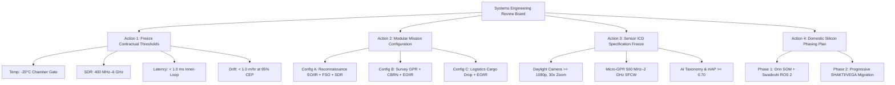

# RudraEdge RE-T1 (Spectra)
## Open Questions, Assumptions, Dependencies & Clarification Register

### 1. Document Control

| Document Control Field | Information / Specification |
|---|---|
| **Document Title** | Open Questions, Assumptions, Dependencies & Clarification Register |
| **Project Name** | Project Rudra-Tactical \| Platform: RudraEdge RE-T1 (Spectra) |
| **Document Identifier** | `REA-T1-OQAD-2026-V1.0` / `P06_Open_Questions_and_Assumptions.md` |
| **Revision** | Version 1.0 — Formal Baseline Register |
| **Release Date** | 23 October 2026 |
| **Assigned Role** | Systems Requirements & Configuration Engineer |
| **Target Framework** | iDEX / DIO / MoD Evaluation Standard |
| **Document Status** | Under Review — Pending Systems Engineering Review Board (SERB) Approval |
| **Governing Specification** | `REA-T1-OVERVIEW-2026-V1.0` (*RudraEdge RE-T1 Spectra: Project Introduction & Technical Overview*, authored by Sarvesh Sharma) |

---

### 2. Purpose and Scope

#### 2.1 Purpose
This document establishes an auditable, configuration-controlled register of all **Open Questions**, **Assumptions**, **Dependencies**, and **Items Requiring Clarification** for the **RudraEdge RE-T1 (Spectra)** autonomous tactical Unmanned Aerial System (UAS). 

Following the completion of the formal Requirements Quality Review ([`P05_Requirements_Quality_Review.xlsx`](file:///c:/Users/Admin/OneDrive/Desktop/Day%203/P05_Requirements_Quality_Review.xlsx)), this register makes all missing specifications, unconfirmed engineering decisions, hardware/software interdependencies, and technical ambiguities visible and traceable to the 37 numbered project requirements baselined in [`P03_Numbered_Requirements_Register.xlsx`](file:///c:/Users/Admin/OneDrive/Desktop/Day%203/repo/Day2/P03_Numbered_Requirements_Register.xlsx).

#### 2.2 Scope and Boundaries
* **In-Scope:** Comprehensive analysis of all 37 baselined system requirements across Functional (`REQ-F-001` to `REQ-F-013`), Security (`REQ-SEC-001` to `REQ-SEC-002`), Performance (`REQ-P-001` to `REQ-P-010`), Safety (`REQ-S-001` to `REQ-S-006`), and Documentation (`REQ-D-001` to `REQ-D-006`) categories.
* **Traceability Scope:** Direct linkage to findings in `P05` (19 Review Issues, 12 Duplicate/Conflict Findings) and `P04` (Section 3.2 Assumptions and Section 6 Technical Gap Registry).
* **Strict Governance Rules:**
  1. No requirement is rewritten, deleted, merged, or silently approved.
  2. All proposed solutions remain recommendations pending authorization by the Systems Engineering Review Board (SERB) and Project Lead Sarvesh Sharma.
  3. Documented project facts are rigorously separated from provisional working assumptions and open technical gaps.
  4. In conformance with project instructions, all preliminary dummy files from Day 1 are excluded; authoritative data originates exclusively from official project documents (`REA-T1-OVERVIEW-2026-V1.0`, `P03`, `P04`, and `P05`).

---

### 3. Source Documents Reviewed

The findings, registers, and trace matrices in this deliverable are derived from the following authoritative project artifacts:

| Document Reference | Document Title / Description | Author / Authority | Baseline Version / Date | Relevance to this Register |
|---|---|---|---|---|
| **REA-T1-OVERVIEW-2026-V1.0** | *RudraEdge RE-T1 (Spectra) Project Introduction & Technical Overview* | Sarvesh Sharma (Founder & Project Lead) | Version 1.0 (2026) | Authoritative architectural blueprint; defines 8-Layer PECLF architecture, 20 frozen capabilities, 10-Tier Validation Ladder, and 18-month lifecycle. |
| **RE-iDEX-PROPOSAL-2026-R1** | *Master Proposal: Autonomous Tactical UAV • Multi-Sensor Edge-AI* | RudraEdge Aerospace / iDEX DIO MoD | Official Proposal (2026) | Master defense innovation proposal establishing target high-altitude operational regimes, payload requirements, and evaluation gates. |
| **P03_Numbered_Requirements_Register.xlsx** | *Numbered Requirements Register* | Systems Requirements & Configuration Engineer | Release 1.0 (23 Oct 2026) | 14-column master requirements ledger containing all 37 uniquely numbered system requirements (`REQ-F-001` to `REQ-D-006`). |
| **P04_Requirements_Acceptance_Criteria.md** | *Requirements Acceptance Criteria and Verification Plan* | Systems Requirements & Configuration Engineer | Release 1.0 (23 Oct 2026) | Detailed acceptance criteria, verification procedures, pass/fail rules, Section 3.2 working assumptions, and Section 6 technical gaps. |
| **P05_Requirements_Quality_Review.xlsx** | *Requirements Quality Review Register* | Systems Requirements & Configuration Engineer | Release 1.0 (23 Oct 2026) | Comprehensive 5-attribute quality audit (Ambiguity, Duplication, Conflicts, Feasibility, Testability) detailing 19 logged issues and 12 findings. |

---

### 4. Open Questions Register

The following register documents critical technical questions that cannot be conclusively answered from current project documentation. Each question identifies the specific engineering decision or external vendor data required to achieve baseline freeze.

| Question ID | Related Requirement ID(s) | Open Question Description | Reason Question Remains Unanswered | Information / Decision Required | Suggested Responsible Authority | Priority | Status |
|---|---|---|---|---|---|:---:|:---:|
| **OQ-001** | `REQ-P-004` | What is the binding contractual sub-zero environmental temperature qualification threshold: -20°C or -30°C? | REA-T1 Section 9 (M2) and Section 10 (Tier 5) specify -20°C, whereas REQ-P-004 text retains a parenthetical -30°C evaluation from early proposal drafts. | Contractual decision whether -20°C is the formal pass/fail chamber gate and -30°C is an exploratory non-destructive characterization. | Systems Engineering Review Board (SERB) / Project Lead | **Critical** | Open |
| **OQ-002** | `REQ-P-010`, `REQ-F-009` | What is the mandatory frequency monitoring band for the airborne Software-Defined Radio (SDR): 400 MHz–6 GHz or 10 MHz–6 GHz? | REA-T1 Module 04 explicitly specifies 400 MHz to 6 GHz. REQ-P-010 includes a parenthetical design evaluation down to 10 MHz. Airborne antennas for 10 MHz require meters of physical length, creating severe SWaP-C and aerodynamic violations. | Formal confirmation to freeze 400 MHz–6 GHz for the airframe SDR and relegate 10–400 MHz to an optional ground annex. | RF & Electronic Warfare Lead | **Critical** | Open |
| **OQ-003** | `REQ-P-001`, `REQ-F-005` | Which inner-loop flight control latency metric governs formal firmware verification: < 1.0 ms or < 250 µs? | REA-T1 Tier 3 exit criteria officially specifies inner-loop latency under 1 millisecond (< 1 ms). Preliminary working drafts cited < 250 µs as a stretch target. | Formal confirmation of < 1.0 ms as the contractual pass/fail ceiling on bare-metal Cortex-M7 hardware. | Flight Control & Avionics Lead | **Major** | Open |
| **OQ-004** | `REQ-P-005`, `REQ-F-004` | What exact statistical confidence interval governs the GNSS-denied positional drift bound (< 1.0 m/hr)? | REQ-P-005 states '< 0.8m to 1.0m per hour' without defining whether compliance is measured as 1-sigma RMS, 2-sigma, or 95% Circular Error Probable (CEP). | Statistical standard definition for navigation trajectory error analysis in Gazebo digital twin and GNSS-denied test corridors. | Navigation & Guidance (GNC) Lead | **Major** | Open |
| **OQ-005** | `REQ-F-013`, `REQ-P-002` | Can the tactical airframe concurrently carry the full multi-sensor payload suite AND the cargo drop pod at 6,500 m AMSL? | Operating all multi-modal sensors (EO/IR, LiDAR, GPR, SDR, FSO laser, acoustic array) concurrently with a cargo pod at 6,500 m AMSL (~0.65 kg/m³ air density) challenges the MTOW lift budget. | Operational concept decision whether payloads operate in swappable modular mission configurations or concurrent all-up flight. | Systems Engineering Review Board (SERB) | **Critical** | Open |
| **OQ-006** | `REQ-P-007`, `REQ-P-008` | What is the formal phased transition milestone for migrating from commercial edge SOMs to domestic C-DAC VEGA / SHAKTI silicon? | REA-T1 mandates 100% Indian IP sovereignty, but executing 60 FPS INT8 inference and multi-model neural vision requires multi-TOPS AI accelerators currently unavailable in domestic silicon. | Phased roadmap freeze: Phase 1/Alpha prototypes utilize commercial heterogeneous SOMs with open APIs; Phase 2 executes avionics migration to domestic silicon. | Systems Architecture & Compute Lead | **Major** | Open |
| **OQ-007** | `REQ-F-001` | What are the mandatory sensor resolution, horizontal FOV, and optical zoom ratios for the daylight CMOS and LWIR bolometer cameras? | REA-T1 Module 02 specifies dual-stream MIPI-CSI video ingress, but specific optical sensor hardware selection is pending vendor finalization. | Optical sensor resolution (e.g., 1080p vs 4K), frame rate (30 vs 60 fps), focal length, and continuous zoom factor freeze. | Electro-Optics & Payload Lead | **Major** | Open |
| **OQ-008** | `REQ-F-002` | What are the RF center frequency, sweep bandwidth, and target soil/ice penetration depth metrics for the micro-GPR antenna? | REA-T1 Module 04 specifies 16-bit IQ sample ingress over SPI/USB 3.0, but detailed radar RF front-end specifications remain undefined. | Center frequency (MHz/GHz), bandwidth (MHz), and required penetration depth (e.g., >= 1.5 m in dry glacial ice) freeze. | Subsurface Radar & DSP Lead | **Major** | Open |
| **OQ-009** | `REQ-F-003` | What acoustic sampling frequency and impulse noise detection sensitivity thresholds govern the 4-channel microphone array? | Requirement specifies 4-channel ingress and TDoA processing, but omits ADC sampling rate (kHz) and detection sensitivity under 25 m/s mountain wind shear. | Sampling rate (>= 48 kHz, 24-bit ADC), impulse sensitivity threshold (dB SPL), and wind noise filtering parameter freeze. | Signal Processing & Avionics Lead | **Moderate** | Open |
| **OQ-010** | `REQ-F-006` | What is the approved tactical target classification taxonomy and minimum acceptable detection accuracy threshold (mAP@0.50)? | Requirement specifies onboard neural object detection without cloud reliance, but 'tactical targets' is undefined without an approved military taxonomy. | Target class taxonomy (personnel, vehicles, fortifications) and minimum quantitative accuracy baseline (e.g., mAP@0.50 >= 0.70 at 1080p). | Edge AI & Deep Learning Lead | **Major** | Open |
| **OQ-011** | `REQ-F-007` | What standard semantic terrain class labels and minimum acceptable mean Intersection-over-Union (mIoU) percentage are required? | Vision transformer segmentation mandates pixel-level masks, but lack of defined terrain classes and mIoU targets prevents objective pass/fail scoring. | Standard terrain classes (snow, rock, water, foliage, structures), target mIoU (>= 75%), and execution latency budget freeze. | Computer Vision & Edge AI Lead | **Major** | Open |
| **OQ-012** | `REQ-F-008` | What are the minimum detectable physical dimensions of ground disturbances and the allowable geo-referencing spatial tolerance? | Comparative change detection mandates flagging fortifications and tracks, but omits minimum track width (m) and false alarm probability (Pfa). | Minimum physical disturbance dimensions (meters), geo-registration accuracy threshold, and allowable false alarm rate freeze. | Mission Intelligence & AI Lead | **Moderate** | Open |
| **OQ-013** | `REQ-F-011`, `REQ-P-006` | What is the maximum allowable laser pointing jitter in microradians (µrad) and link re-acquisition latency budget following beam break? | Coarse-fine PAT control loop specifies vibration compensation, but lacks quantitative beam jitter bounds and atmospheric visibility constraints. | Maximum allowable pointing jitter (<= 15 µrad RMS), link re-acquisition budget (<= 200 ms), and visibility threshold (>= 20 km) freeze. | Optical Communications & GNC Lead | **Major** | Open |
| **OQ-014** | `REQ-P-008` | To which specific neural models does the 'up to 60 FPS' INT8 throughput requirement apply, and at what input tensor resolution? | Requirement specifies up to 60 FPS under INT8 quantization without allocating frame rate budgets across object detection, segmentation, and change detection. | Input tensor resolution (e.g., 640x640), batch size, and explicit model allocation (60 FPS for 2D detector; >= 15 FPS for segmentation) freeze. | Edge AI Software Lead | **Major** | Open |
| **OQ-015** | `REQ-P-009` | Across which exact angular aspect cones (azimuth/elevation) must the airframe sustain the < 0.01 m² Radar Cross-Section? | Requirement states 'target estimated < 0.01 m²' without bounding the angular sector (+/- 45° frontal cone vs all-aspect 360°). | Aspect angle boundary freeze (+/- 45° azimuth, +/- 15° elevation frontal cone) and formal anechoic chamber test protocol definition. | Aerospace & Stealth Structures Lead | **Major** | Open |
| **OQ-016** | `REQ-S-002` | Which specific aerospace safety standard and Design Assurance Levels (DAL) govern software and airborne hardware compliance? | Requirement lists alternative standards ('DO-178C / DO-254 / iDEX Evaluation Standard') without allocating specific DAL levels across subsystems. | Formal safety baseline freeze: iDEX framework as primary standard, with PX4 Autopilot mapped to DAL B and Edge AI mapped to DAL D. | Systems Safety & Certification Lead | **Moderate** | Open |

---

### 5. Assumptions Register

This register details all working engineering assumptions provisionally adopted to advance systems engineering, simulation modeling, and verification planning. Documented assumptions (originating from `REA-T1` and `P04` Section 3.2) are explicitly distinguished from newly proposed working assumptions.

| Assumption ID | Related Requirement ID(s) | Assumption Classification | Assumption Description | Reason for the Assumption | Impact if Assumption Is Incorrect | Validation / Confirmation Required | Suggested Owner | Status |
|---|---|:---:|---|---|---|---|---|:---:|
| **ASM-001** | `REQ-P-002` | **Documented Assumption** | The propulsion system delivers at least 1.0 m/s residual climb rate at 6,500 m AMSL in standard low air density (~0.65 kg/m³). | Derived from `P04` Section 3.2 and `REA-T1` Section 2.2 to establish a quantitative climb margin at operational ceiling. | If residual climb is lower, aircraft cannot safely maneuver or clear Himalayan mountain ridgelines under turbulence. | Hypobaric chamber thrust stand testing (440 hPa) and Gazebo CFD simulation in Milestone 1. | Aerodynamics & Propulsion Lead | Active / Pending Test |
| **ASM-002** | `REQ-P-003` | **Documented Assumption** | Mountain wind shear gusts of 25.0 m/s have a maximum sustained duration of 3.0 seconds, with recovery within <= 2.5 seconds. | Documented in `P04` Section 3.2 to bound discrete '1-cosine' gust profiles during Gazebo simulation. | If sustained gusts exceed 3 seconds, battery current draw and control surface actuator stall limits may be exceeded. | High-fidelity Dryden and von Kármán wind turbulence injection in Gazebo SITL. | Flight Dynamics & Simulation Lead | Active / Pending Test |
| **ASM-003** | `REQ-P-004` | **Documented Assumption** | -20°C represents the mandatory environmental chamber qualification threshold; -30°C represents an exploratory non-destructive survival limit. | Aligned with `REA-T1` Section 9 (M2) and Section 10 (Tier 5 exit criteria); resolves conflict with draft proposal. | If -30°C is enforced contractually, battery thermal insulation mass and heating power must increase significantly, reducing payload capacity. | Environmental chamber test protocol sign-off in Milestone 2 HIL plan. | Thermal & Environmental Lead | Active / Pending Sign-Off |
| **ASM-004** | `REQ-P-001` | **Documented Assumption** | Inner-loop flight control latency is contractually bounded at < 1.0 ms; < 250 µs is preserved strictly as an internal engineering stretch goal. | Directly derived from `REA-T1` Section 10 Tier 3 exit criteria ('Inner-loop latency under 1 millisecond'). | Enforcing < 250 µs as a contractual requirement would require stripping safety-critical Kalman filtering and attitude cross-coupling logic. | Oscilloscope and hardware timer profiling on bare-metal STM32 HIL bench. | Flight Control & Avionics Lead | Active / Pending Sign-Off |
| **ASM-005** | `REQ-P-005` | **Documented Assumption** | GNSS-denied horizontal positional drift is bounded at < 1.0 m per flight hour evaluated at a 95% Circular Error Probable (CEP) confidence level. | Harmonizes `REA-T1` Tier 8 exit criteria ('Sub-meter drift bounds sustained') with standard military navigation accuracy metrics. | If 1-sigma RMS is assumed instead of 95% CEP, test results will fail defense evaluation criteria during trajectory audits. | Optical ground-truth test corridor trajectory verification in Milestone 4 / Tier 8. | Navigation & Guidance (GNC) Lead | Active / Pending Test |
| **ASM-006** | `REQ-P-006` | **Documented Assumption** | Directional FSO data throughput >= 1.2 Gbps over 18 km requires clear line-of-sight atmospheric conditions (visibility >= 20 km). | Documented in `P04` Section 3.2; standard optical link budget physics dictate high attenuation in heavy mountain fog or dense clouds. | If evaluators expect 1.2 Gbps through dense clouds, the requirement will fail; automated fallback to SDR RF (`REQ-F-012`) must engage. | Terrestrial line-of-sight optical link budget and bit error rate testing in Milestone 4. | Optical Communications Lead | Active / Pending Test |
| **ASM-007** | `REQ-P-007` | **Documented Assumption** | Phase 1 development utilizes commercial heterogeneous SOM hardware (e.g., Jetson Orin Industrial 275 TOPS) abstracted via ONNX/POSIX to enable Phase 2 domestic silicon migration. | Necessary to satisfy 60 FPS INT8 inference and multi-sensor edge AI workloads while domestic RISC-V processors (VEGA/SHAKTI) mature. | Attempting to deploy non-accelerated domestic silicon in Phase 1 would prevent execution of core neural perception capabilities. | Architecture review and portability audit against open API standards. | Systems Architecture Lead | Active / Pending Sign-Off |
| **ASM-008** | `REQ-P-010` | **Documented Assumption** | The airborne SDR RF spectrum monitoring antenna and front-end operate strictly across 400 MHz to 6.0 GHz. | Derived directly from `REA-T1` Section 7 Module 04 ('Wideband SDR RF antenna inputs 400 MHz to 6 GHz'). | Integrating a 10 MHz HF antenna on the tactical UAV airframe would induce severe aerodynamic drag and structural weight penalties. | RF chamber tuner sweep testing and VSWR antenna matching measurements. | RF & EW Systems Lead | Active / Pending Sign-Off |
| **ASM-009** | `REQ-F-013`, `REQ-P-002` | **Documented Assumption** | Maximum Takeoff Weight (MTOW) is ~25–40 kg; payloads operate in modular mission configurations rather than concurrent all-up deployment. | Documented in `P04` Section 3.2; high-altitude aerodynamics at 6,500 m AMSL cannot support simultaneous carriage of all sensors plus cargo pod. | Airframe structural failure or aerodynamic stall if all payloads are integrated and flown simultaneously at high altitude. | Structural weight budget sign-off and modular payload bracket design in Milestone 3. | Mechanical & Airframe Lead | Active / Pending Sign-Off |
| **ASM-010** | `REQ-F-001` | **Newly Proposed Assumption** | Daylight optical camera operates at minimum 1080p (1920x1080) resolution at >= 30 fps with continuous 30x optical zoom; LWIR bolometer operates at 640x512 at 30 fps. | Proposed based on standard tactical UAS payload market availability to enable concrete perception test planning. | If lower resolution sensors are selected, optical target detection range and pixel density on target will be degraded. | Sensor vendor datasheet review and payload Interface Control Document (ICD) baseline. | Electro-Optics Lead | Proposed / Unconfirmed |
| **ASM-011** | `REQ-F-002` | **Newly Proposed Assumption** | Micro-GPR operates in stepped-frequency continuous-wave (SFCW) mode between 500 MHz and 2.0 GHz, achieving >= 1.5 m penetration depth in dry glacial snow/ice. | Proposed based on lightweight airborne ground penetrating radar physics for avalanche and crevasse detection. | Radar front-end hardware mismatch; failure to resolve subsurface crevasses or buried logistic targets in Himalayan snowfields. | Radar payload specification sign-off and simulated echo processing benchtop testing. | Subsurface Radar Lead | Proposed / Unconfirmed |
| **ASM-012** | `REQ-P-008` | **Newly Proposed Assumption** | The 60 FPS INT8 throughput requirement applies specifically to single-frame 640x640 2D tactical object detection models, while semantic segmentation operates at >= 15 FPS. | Proposed based on edge GPU memory bandwidth limitations when concurrently executing heavy transformer architectures. | If 60 FPS is mandated for full pixel-level vision transformers, compute hardware will thrash memory and exceed thermal limits. | TensorRT INT8 benchmarking report and multi-model execution profiling on benchtop rig. | Edge AI Software Lead | Proposed / Unconfirmed |
| **ASM-013** | `REQ-P-009` | **Newly Proposed Assumption** | Radar Cross-Section reduction of < 0.01 m² is evaluated across frontal and lateral aspect cones (+/- 45° azimuth, +/- 15° elevation relative to nose) across X and Ku bands. | Proposed based on stealth tactical UAS doctrine; 360-degree all-aspect < 0.01 m² is unattainable with exposed propeller blades and optical gimbals. | CEM simulation models and anechoic chamber turntable test plans will fail if evaluated against unrealistic all-aspect boundaries. | Computational Electromagnetics (CEM) simulation report and stealth shape review. | Stealth Structures Lead | Proposed / Unconfirmed |
| **ASM-014** | `REQ-S-002` | **Newly Proposed Assumption** | PX4 Autopilot flight stabilization stack is developed to DO-178C DAL B equivalent, while Swadeshi ROS 2 and Edge AI pipelines adhere to DAL D equivalent. | Proposed based on standard aerospace safety partition philosophy isolating flight-critical inner loops from high-level mission compute. | If DAL B is enforced across complex AI neural models, verification costs and timeline will expand beyond the 18-month project lifecycle. | System Safety Plan approval and Hazard Analysis (FHA/FMEA) sign-off. | Systems Safety Lead | Proposed / Unconfirmed |

---

### 6. Dependencies Register

This register maps all critical technical, interface, hardware, software, verification, and governance dependencies across the RudraEdge RE-T1 system architecture. Confirmed dependencies are distinguished from potential dependencies requiring confirmation.

| Dependency ID | Related Requirement ID(s) | Dependency Classification | Dependency Description | Dependent Requirement / Subsystem | Required Input, Interface, or Pre-Condition | Impact if Dependency Is Delayed or Unavailable | Suggested Responsible Team | Status |
|---|---|:---:|---|---|---|---|---|:---:|
| **DEP-001** | `REQ-F-004`, `REQ-F-001` | **Confirmed Dependency** | VIO state estimation depends on continuous high-speed MIPI-CSI optical frame ingress and tactical IMU data streams. | `REQ-F-004` (VIO State Estimation) | Low-latency visual feature points from `REQ-F-001` and 200 Hz IMU angular rates/accelerations. | VIO state estimator suffers rapid drift or divergence; flight controller cannot maintain GNSS-denied navigation. | Navigation (GNC) & Sensor Integration Leads | Confirmed Active |
| **DEP-002** | `REQ-F-005`, `REQ-F-004` | **Confirmed Dependency** | Autonomous waypoint navigation and attitude control depend on drift-bounded 6-DOF kinematic state vectors. | `REQ-F-005` (Autopilot Attitude Control) | 6-DOF pose and velocity vectors published at >= 30 Hz over ROS 2 topics by `REQ-F-004`. | Autopilot loses spatial localization, aborts waypoint mission, and triggers emergency failsafe return-to-home. | Flight Control & Navigation Leads | Confirmed Active |
| **DEP-003** | `REQ-F-006`, `REQ-F-007`, `REQ-F-001` | **Confirmed Dependency** | Onboard neural object detection and semantic terrain segmentation depend on zero-copy MIPI-CSI DMA frame buffers. | `REQ-F-006`, `REQ-F-007` (Edge AI Engines) | Synchronized daylight optical and LWIR thermal image tensors populated in shared host memory without CPU copying. | Frame drops, pipeline latency spikes, and complete failure of real-time target detection and terrain segmentation. | Computer Vision & Edge AI Leads | Confirmed Active |
| **DEP-004** | `REQ-F-008`, `REQ-F-004` | **Confirmed Dependency** | Temporal visual change detection depends on precise geo-referenced camera pose estimation and preloaded terrain embeddings. | `REQ-F-008` (Change Detection) | 6-DOF camera pose from `REQ-F-004` and historical visual embeddings preloaded in encrypted local storage. | Change detection algorithm fails to register incoming frames against historical database, producing false alarms or missed modifications. | Mission Intelligence & AI Leads | Confirmed Active |
| **DEP-005** | `REQ-F-011`, `REQ-F-005` | **Confirmed Dependency** | FSO laser pointing, acquisition, and tracking (PAT) depends on high-rate gyro attitude offsets from the autopilot. | `REQ-F-011` (FSO PAT Mechanism) | 200 Hz vehicle attitude rate and angular coordinate offsets transmitted over RS-422 / high-speed serial. | Optical fast steering mirror cannot compensate for airframe vibration and wind shear, causing loss of laser link lock. | Optical GNC & Flight Control Leads | Confirmed Active |
| **DEP-006** | `REQ-F-010`, `REQ-F-006` | **Confirmed Dependency** | Free-Space Optical telemetry transmission depends on serialized mission intelligence and compressed video streams. | `REQ-F-010` (FSO Data Transmission) | Serialized target coordinates, change alert vectors, and compressed H.265/AV1 video packets from edge compute. | Optical transmitter radiates carrier without payload data; ground terminal receives empty telemetry packets. | Optical Comms & Software Leads | Confirmed Active |
| **DEP-007** | `REQ-F-012`, `REQ-F-010` | **Confirmed Dependency** | Secondary SDR RF telemetry fallback depends on continuous optical link signal-to-noise ratio monitoring. | `REQ-F-012` (Encrypted RF Fallback) | Optical link carrier loss or signal degradation flag generated by FSO receiver within <= 500 ms. | Communications blackout if optical beam is obscured by clouds and automated failover to encrypted SDR RF is delayed. | Secure Communications Lead | Confirmed Active |
| **DEP-008** | `REQ-F-013`, `REQ-F-004`, `REQ-P-003` | **Confirmed Dependency** | Wind-compensated ballistic cargo drop timing depends on real-time wind vector estimation, ground speed, and radar altitude. | `REQ-F-013` (Ballistic Release Actuation) | Accurate horizontal wind speed/direction estimation from EKF and true ground clearance from radar altimeter. | Ballistic drop pod misses target drop coordinates, resulting in lost emergency logistic supplies or collateral impact. | Payload Systems & GNC Leads | Confirmed Active |
| **DEP-009** | `REQ-F-013`, `REQ-S-004` | **Confirmed Dependency** | Cargo drop mechanical pod unlatching depends on dual-redundant opto-isolated hardware discrete safety signals. | `REQ-F-013` (Ballistic Release Actuation) | Simultaneous assertion of Channel A and Channel B discrete logic signals within a <= 50 ms coincidence timing window. | Mechanism cannot unlatch if safety interlock fails; premature or uncommanded drop if interlock is bypassed. | Hardware Safety & Payload Leads | Confirmed Active |
| **DEP-010** | `REQ-SEC-001`, `REQ-S-005` | **Confirmed Dependency** | Hardened OS and Swadeshi ROS 2 node execution depend on cryptographic authentication by Hardware Root of Trust. | `REQ-S-005`, `REQ-F-005` (Operating Software Stack) | Valid public key certificates in TPM 2.0 enclave and cryptographically signed Stage 1/Stage 2 bootloaders. | System halts boot sequence immediately upon detecting corrupted or unsigned binaries, preventing unauthorized flight. | Cybersecurity & Firmware Leads | Confirmed Active |
| **DEP-011** | `REQ-S-001`, `REQ-F-005` | **Confirmed Dependency** | Deterministic flight control execution depends on physical processor separation and galvanically isolated power rails. | `REQ-F-005` (Autopilot Attitude Control) | Dedicated bare-metal microcontroller hardware independent of Linux edge compute board and separate voltage regulators. | Linux OS kernel panic, GPU thermal brownout, or memory thrashing corrupts flight control loop, inducing vehicle crash. | Avionics Hardware & Safety Leads | Confirmed Active |
| **DEP-012** | `REQ-S-003`, `REQ-F-005` | **Confirmed Dependency** | Autonomous return-to-home failsafe engagement depends on hardware watchdog heartbeat timer expiration (500 ms). | `REQ-F-005` (Autopilot Failsafe Mode) | Continuous 10 Hz bidirectional heartbeat packet exchange between flight controller and edge compute over CAN/Ethernet. | Aircraft continues erratic flight or loses mission coordination if inter-module bus freezes without failsafe trigger. | Avionics & Flight Control Leads | Confirmed Active |
| **DEP-013** | `REQ-S-006`, `REQ-P-004`, `REQ-D-005` | **Confirmed Dependency** | Progression to Tier 6 (Tethered Flight Trials) depends on formal sign-offs for Tier 4 (48-hr Bus Collision) and Tier 5 (Thermal Chamber). | Validation Ladder Tier 6 Authorization | Verified 48-hour collision-free bus log and successful -20°C thermal chamber test report signed by engineering leads. | Risk of catastrophic airborne failure during flight trials due to unverified electrical bus stalls or cold-weather freezes. | Systems Engineering & QA Leads | Confirmed Active |
| **DEP-014** | `REQ-D-001`, `REQ-D-002` | **Confirmed Dependency** | Baseline System Requirements Specification (SRS) freeze depends on formal closure of the 20 frozen advanced capabilities. | `REQ-D-001` (Milestone 1 SRS Freeze) | Approved functional decomposition and system boundaries from `REA-T1-OVERVIEW-2026-V1.0` and `P01_Project_Scope_Baseline.md`. | Requirements churn, scope creep, and unaligned subsystem development during subsequent hardware fabrication phases. | Systems Requirements & Project Leads | Confirmed Active |
| **DEP-015** | `REQ-D-006`, `REQ-D-004` | **Confirmed Dependency** | Final Milestone 5 Defense Qualification Dossier depends on complete 10-Tier verification evidence binder and 100% RTM coverage. | `REQ-D-006` (Pre-Induction Defense Dossier) | Verified test reports, flight logs, static analysis certificates, and manufacturing data packages across all 10 tiers. | Defense evaluators reject pre-induction submission under iDEX framework due to missing airworthiness artifacts. | Systems Engineering Review Board (SERB) | Confirmed Active |
| **DEP-016** | `REQ-P-007`, `REQ-D-001` | **Potential Dependency — Confirmation Required** | Integration of domestic C-DAC VEGA / IIT Madras SHAKTI processors depends on national silicon availability schedules. | `REQ-P-007` (Heterogeneous Compute Substrate) | Availability of aerospace-qualified domestic microcontrollers and RISC-V neural accelerators from Indian research agencies. | Project timeline slips if domestic silicon delivery is mandated on critical path before silicon reaches technical maturity. | Systems Architecture & MoD Liaison | Potential / Unconfirmed |
| **DEP-017** | `REQ-P-009`, `REQ-F-001` | **Potential Dependency — Confirmation Required** | Achieving < 0.01 m² RCS depends on radar-absorbing fairings or retractable gimbal mechanisms for external sensors. | `REQ-P-009` (Stealth Airframe RCS) | Structural CAD design incorporating frequency-selective surface (FSS) windows or retractable gimbal housings for EO/IR and GPR. | Airframe RCS exceeds 0.01 m² target due to specular radar reflections from exposed gimbal lenses and antenna metallic structures. | Aerodynamics & Stealth Structures Leads | Potential / Unconfirmed |

---

### 7. Items Requiring Clarification

This register details specific numerical thresholds, ICD interface definitions, and technical boundaries that must be clarified before individual requirements can be finalized, implemented, and verified.

| Clarification ID | Related Requirement ID(s) | Original Requirement Reference | Missing or Unclear Detail | Why Clarification Is Needed | Specific Clarification Requested | Potential Impact if Unresolved | Suggested Responsible Authority | Status |
|---|---|---|---|---|---|---|---|:---:|
| **CLR-001** | `REQ-F-001` | `REQ-F-001` Description | Optical daylight camera sensor resolution, horizontal Field of View (FOV in degrees), lens focal length, and optical zoom ratios. | Optical sensor selection dictates pixel density on target, camera payload mass, and MIPI-CSI bus lane bandwidth. | Formally specify daylight sensor resolution (>= 1080p), horizontal FOV (degrees), and zoom ratio in the Sensor ICD. | Electro-optics bench testing cannot define pass/fail spatial resolution criteria. | Electro-Optics & Payload Lead | Needs Clarification |
| **CLR-002** | `REQ-F-002` | `REQ-F-002` Description | Micro-GPR RF center frequency, frequency sweep bandwidth (MHz), PRF, and required soil/ice penetration depth (m). | Radar echo processing algorithms and antenna RF matching networks cannot be designed without center frequency and bandwidth. | Baseline RF operating band, center frequency, sweep bandwidth, and target penetration depth (>= 1.5 m in ice) in radar ICD. | GPR subsystem cannot be integrated or verified against objective subsurface detection criteria. | Subsurface Radar & DSP Lead | Needs Clarification |
| **CLR-003** | `REQ-F-003` | `REQ-F-003` Description | Acoustic sampling frequency (kHz) and minimum acoustic impulse detection sensitivity threshold (dB SPL). | Dictates DSP buffer sizing, ADC hardware selection, and acoustic noise filtering thresholds under turbulent winds. | Quantify acoustic sampling rate (>= 48 kHz, 24-bit ADC) and impulse detection sensitivity range in acoustic specification. | Acoustic bearing estimator may fail to detect simulated gunfire or saturate under high-speed motor rotor noise. | Signal Processing & Avionics Lead | Needs Clarification |
| **CLR-004** | `REQ-F-006` | `REQ-F-006` Description | Formal tactical target classification taxonomy and minimum acceptable mean Average Precision (mAP@0.50) threshold. | 'Tactical targets' is vague; without an approved class list and mAP threshold, object detection performance cannot be objectively scored. | Establish formal tactical target class taxonomy and baseline minimum detection threshold (mAP@0.50 >= 0.70 at 1080p). | Subjective evaluation disputes during defense flight demonstrations regarding target detection efficacy. | Edge AI & Deep Learning Lead | Needs Clarification |
| **CLR-005** | `REQ-F-007` | `REQ-F-007` Description | Standardized semantic terrain class labels, target mean Intersection-over-Union (mIoU) percentage, and execution latency. | Autonomous obstacle avoidance and safe landing evaluation cannot be objectively verified without approved class definitions. | Define standard semantic terrain class labels, baseline target mIoU (>= 75%), and specify maximum permissible latency (<= 50 ms). | Vision transformer segmentation cannot be validated for real-time terrain hazard avoidance. | Computer Vision & Edge AI Lead | Needs Clarification |
| **CLR-006** | `REQ-F-008` | `REQ-F-008` Description | Minimum detectable ground disturbance physical dimensions (meters) and image geo-referencing spatial registration error tolerance. | Prevents objective verification of whether small fortifications or minor vehicle tracks must trigger automated tactical alerts. | Specify minimum detectable ground disturbance physical dimensions (m), geo-registration accuracy, and allowable false alarm rate. | Algorithm produces continuous false alarms or misses critical enemy fortifications. | Mission Intelligence & AI Lead | Needs Clarification |
| **CLR-007** | `REQ-F-011` | `REQ-F-011` Description | Maximum allowable laser pointing jitter in microradians (µrad) and link re-acquisition latency budget (ms) following optical disruption. | High wind shear PAT testing on motion vibration tables cannot establish clear pass/fail beam divergence boundaries without jitter bounds. | Baseline maximum allowable beam jitter (<= 15 µrad RMS) and maximum link re-acquisition duration (<= 200 ms) in GNC baseline. | Optical communications link drops intermittently during high-altitude turbulence with unpredictable re-acquisition times. | Optical Communications & GNC Lead | Needs Clarification |
| **CLR-008** | `REQ-F-013` | `REQ-F-013` Description | Cargo drop pod maximum payload mass capacity (kg), internal volumetric dimensions, and Circular Error Probable (CEP) delivery accuracy. | Airframe structural hardpoint stress calculations and ballistic calculator trajectory tuning depend on mass properties and accuracy requirements. | Define maximum cargo payload mass (e.g., 5.0 kg), dimensions, and required delivery accuracy (CEP <= 5.0 m from 150 m AGL). | Mechanical cargo mechanism cannot be fabricated and ballistic software release triggers cannot be calibrated. | Mechanical & Payload Systems Lead | Needs Clarification |
| **CLR-009** | `REQ-P-001` | `REQ-P-001` AC-P-1.4 | Confirmation that < 1.0 ms is the formal contractual pass/fail ceiling and < 250 µs is strictly an internal optimization goal. | Prevents firmware developers from prematurely stripping safety logic to satisfy an unverified stretch target. | Formally sign off < 1.0 ms as the binding acceptance criterion per REA-T1 Tier 3 exit criteria. | Inconsistent pass/fail scoring during Milestone 2 HIL benchtop testing. | Flight Control & Avionics Lead | Needs Clarification |
| **CLR-010** | `REQ-P-004` | `REQ-P-004` Description | Confirmation whether -20°C is the formal environmental qualification boundary and -30°C represents an exploratory survival limit. | Dictates battery heater power consumption budgets and thermal insulation thickness in the carbon-composite airframe. | Formally baseline -20°C as contractual chamber gate and relegate -30°C to non-destructive survival characterization. | Over-engineering thermal insulation increases airframe empty weight and degrades high-altitude flight endurance. | Thermal & Environmental Lead | Needs Clarification |
| **CLR-011** | `REQ-P-005` | `REQ-P-005` Description | Statistical confidence interval (1-sigma RMS vs 95% CEP) governing the < 1.0 m drift bound over 1 hour of GNSS-denied flight. | Range phrasing ('< 0.8m to 1.0m') creates mathematical ambiguity during trajectory error computation. | Standardize acceptance criterion to 'cumulative horizontal drift < 1.0 m per flight hour at 95% CEP'. | Trajectory validation logs in Gazebo digital twin will be contested by defense evaluators. | Navigation & Guidance (GNC) Lead | Needs Clarification |
| **CLR-012** | `REQ-P-008` | `REQ-P-008` Description | Standard input tensor resolution (640x640 vs 1080p), batch size, and target model allocation for the 60 FPS INT8 inference requirement. | Throughput cannot be validated without freezing input tensor dimensions; larger matrices require higher computational TOPS. | Explicitly scope 60 FPS to 640x640 single-frame INT8 object detection; allocate separate frame rates for segmentation (>= 15 FPS). | Compute engine memory thrashing and thermal throttling under full multi-modal neural execution. | Edge AI Software Lead | Needs Clarification |
| **CLR-013** | `REQ-P-009` | `REQ-P-009` Description | Turntable angular aspect cones (+/- 45° frontal vs 360° all-aspect) and frequency test increments for < 0.01 m² RCS measurement. | Anechoic chamber testing cannot be conducted without defined angular measurement sectors and polarized frequency bands. | Baseline average monostatic RCS of < 0.01 m² across frontal/lateral sectors (+/- 45° azimuth, +/- 15° elevation) across 8–18 GHz. | Unrealistic all-aspect RCS failure due to specular reflections from rotating propellers and sensor optical windows. | Stealth Structures & CEM Lead | Needs Clarification |
| **CLR-014** | `REQ-P-010` | `REQ-P-010` Description | Formal removal of the parenthetical '10 MHz to 6 GHz' design evaluation and freezing of the 400 MHz to 6.0 GHz SDR tuning band. | Resolves physical and aerodynamic conflict between airframe antenna dimensions and wideband RF monitoring. | Freeze airborne SDR monitoring band to 400 MHz–6 GHz; document HF monitoring as a ground station annex. | Procurement of oversized, aerodynamically unfeasible airborne antennas that degrade tactical flight stability. | RF & EW Systems Lead | Needs Clarification |

---

### 8. Cross-References to Requirements Quality Review (`P05`)

This section establishes complete bidirectional traceability between the entries in this register and the findings in [`P05_Requirements_Quality_Review.xlsx`](file:///c:/Users/Admin/OneDrive/Desktop/Day%203/P05_Requirements_Quality_Review.xlsx).

| Open Question / Clarification ID | Primary Requirement ID | P05 Issue ID (`Sheet 4`) | P05 Finding ID (`Sheet 2`) | Cross-Referenced Quality Review Finding Summary |
|---|---|---|---|---|
| `OQ-001` / `CLR-010` | `REQ-P-004` | `ISSUE-011` (Critical) | `FIND-CONF-003` | Environmental qualification temperature conflict (-20°C in REA-T1 M2/Tier 5 vs -30°C in draft proposal). |
| `OQ-002` / `CLR-014` | `REQ-P-010`, `REQ-F-009` | `ISSUE-017` (Critical) | `FIND-CONF-002`, `FIND-DUP-002` | SDR frequency band conflict (400 MHz–6 GHz in REA-T1 Mod 04 vs 10 MHz–6 GHz in draft proposal). |
| `OQ-003` / `CLR-009` | `REQ-P-001`, `REQ-F-005` | `ISSUE-009` (Moderate) | `FIND-CONF-001` | Inner-loop flight control latency target discrepancy (< 1.0 ms in REA-T1 Tier 3 vs < 250 µs stretch goal). |
| `OQ-004` / `CLR-011` | `REQ-P-005`, `REQ-F-004` | `ISSUE-012` (Major) | `FIND-CONF-004`, `FIND-DUP-003` | GNSS-denied drift bound range phrasing ambiguity (< 0.8m to 1.0m/hr) and missing statistical CEP confidence interval. |
| `OQ-005` | `REQ-F-013`, `REQ-P-002` | `ISSUE-019` (Critical) | `FIND-CONF-006` | High-altitude payload SWaP-C and MTOW lift conflict at 6,500 m AMSL under concurrent multi-sensor + cargo carriage. |
| `OQ-006` | `REQ-P-007`, `REQ-P-008` | `ISSUE-014` (Major) | `FIND-CONF-005` | Domestic silicon roadmap tension: near-term edge AI compute throughput (60 FPS INT8) vs C-DAC VEGA / SHAKTI availability. |
| `OQ-007` / `CLR-001` | `REQ-F-001` | `ISSUE-001` (Major) | — | Daylight optical CMOS and LWIR bolometer resolution, FOV, and zoom parameters omitted in requirements text. |
| `OQ-008` / `CLR-002` | `REQ-F-002` | `ISSUE-002` (Major) | — | Micro-GPR RF center frequency, sweep bandwidth, and subsurface penetration depth undefined. |
| `OQ-009` / `CLR-003` | `REQ-F-003` | `ISSUE-003` (Moderate) | — | Acoustic sampling frequency, sensitivity threshold, and wind noise suppression bounds missing. |
| `OQ-010` / `CLR-004` | `REQ-F-006` | `ISSUE-004` (Major) | `FIND-DUP-004` | Tactical target classification taxonomy and minimum acceptable detection accuracy threshold (mAP@0.50) undefined. |
| `OQ-011` / `CLR-005` | `REQ-F-007` | `ISSUE-005` (Major) | `FIND-DUP-004` | Standardized semantic terrain class labels, target mIoU percentage, and execution latency missing. |
| `OQ-012` / `CLR-006` | `REQ-F-008` | `ISSUE-006` (Moderate) | `FIND-DUP-004` | Ground disturbance physical dimensions (meters) and geo-referencing spatial registration bounds missing. |
| `OQ-013` / `CLR-007` | `REQ-F-011`, `REQ-P-006` | `ISSUE-007` (Major), `ISSUE-013` | `FIND-DUP-001` | FSO laser pointing jitter, link re-acquisition budget, and clear atmospheric visibility constraints undefined. |
| `OQ-014` / `CLR-012` | `REQ-P-008` | `ISSUE-015` (Major) | `FIND-DUP-004` | Neural inference throughput ceiling phrasing ('up to 60 FPS') and input tensor resolution missing. |
| `OQ-015` / `CLR-013` | `REQ-P-009` | `ISSUE-016` (Major) | — | Radar Cross-Section subjective phrasing ('target estimated') and aspect angle sectors missing. |
| `OQ-016` | `REQ-S-002`, `REQ-D-004` | `ISSUE-018` (Moderate) | `FIND-DUP-005` | Ambiguous aerospace standards selection and missing subsystem Design Assurance Level (DAL) allocations. |

---

### 9. Priority Items and Recommended Next Actions

To maintain the 18-month phased engineering lifecycle and ensure a successful Milestone 1 System Requirements Specification (SRS) freeze, the following priority actions are recommended:

#### Immediate Recommended Actions (Milestone 1 — Months 1–4):
1. **Contractual Parameter Harmonization (SERB Action):**
   * Formally resolve the three major parameter conflicts identified in `FIND-CONF-001`, `FIND-CONF-002`, and `FIND-CONF-003`:
     - Freeze **-20°C** as the environmental chamber pass/fail gate (`REQ-P-004`).
     - Freeze **400 MHz to 6.0 GHz** as the airborne SDR monitoring band (`REQ-P-010`).
     - Freeze **< 1.0 ms** as the binding inner-loop control latency ceiling (`REQ-P-001`).
     - Standardize navigation drift to **< 1.0 m/hr at 95% CEP** (`REQ-P-005`).
2. **Operational Modular Payload Policy Freeze (Airframe Lead Action):**
   * Resolve `FIND-CONF-006` by formally adopting modular payload configurations in `P01_Project_Scope_Baseline.md` to prevent MTOW exceedance at 6,500 m AMSL. Establish distinct flight cards for Tactical Reconnaissance, Subsurface Survey, and Emergency Logistics.
3. **Payload Interface Control Document (ICD) Baseline (Sensor Leads Action):**
   * Freeze missing sensor specifications (`CLR-001` through `CLR-008`): camera resolution (>= 1080p), micro-GPR operating band (500 MHz–2 GHz), acoustic sampling rate (>= 48 kHz), tactical AI target taxonomy, and cargo pod mass (5 kg).
4. **Domestic Silicon Migration Roadmap Formalization (Systems Architecture Action):**
   * Resolve `FIND-CONF-005` by publishing a formal Two-Phase Silicon Indigenisation Strategy: Phase 1 establishes functional flight prototypes using commercial SOMs running indigenous Swadeshi ROS 2 and secure bootloaders; Phase 2 executes progressive hardware migration to C-DAC VEGA and IIT Madras SHAKTI silicon as domestic AI coprocessors mature.

---

### 10. Unresolved Issues and Limitations

#### 10.1 Project Boundaries and Document Constraints
* **Exclusion of Preliminary Data:** All analysis strictly excluded preliminary draft materials from Day 1 in accordance with project instructions. All data traces directly to official baseline deliverables.
* **Desk-Based Review Boundary:** This engineering review is strictly bounded to requirements analysis, configuration management, and verification planning. No physical hardware fabrication, laboratory chamber operations, or flight trials were conducted.
* **No Premature Verification Claims:** In adherence to systems engineering ethics, zero requirements are claimed as verified or approved. All entries remain designated as `Open`, `Active / Pending Test`, or `Proposed / Unconfirmed`.

#### 10.2 Open Information Gaps Pending External Inputs
* **Sensor Vendor Datasheets:** Final optical Field of View, GPR pulse repetition frequencies, and acoustic transducer sensitivity curves depend on external hardware vendor selection currently underway in Milestone 1.
* **Classified Payload ICDs:** Specific defense data link encryption keys, military frequency hopping hopping patterns, and classified EW threat emitter libraries will be populated following formal MoD project sanction.

---

### 11. Review and Approval Status

This register has been compiled and reviewed under the systems engineering governance framework of Project Rudra-Tactical. Final authorization is pending review by the Systems Engineering Review Board (SERB).

| Review / Approval Role | Designee Name | Organization / Department | Review Status | Date |
|---|---|---|:---:|:---:|
| **Prepared By (Systems Requirements Engineer)** | Priyanka Sharma | Systems Requirements & Configuration Engineering | **Submitted for Review** | 23 October 2026 |
| **Reviewed By (Systems Engineering Lead)** | Assigned Lead Engineer | Systems Engineering Division, RudraEdge Aerospace | **Pending SERB Review** | — |
| **Approved By (Project Lead & Founder)** | Sarvesh Sharma | RudraEdge Aerospace, India | **Pending Authorization** | — |

*Formal Integrity Note: All entries in this register represent objective requirements engineering findings and recommendations. No approved system requirement has been altered or replaced without formal Engineering Change Proposal (ECP) authorization.*
